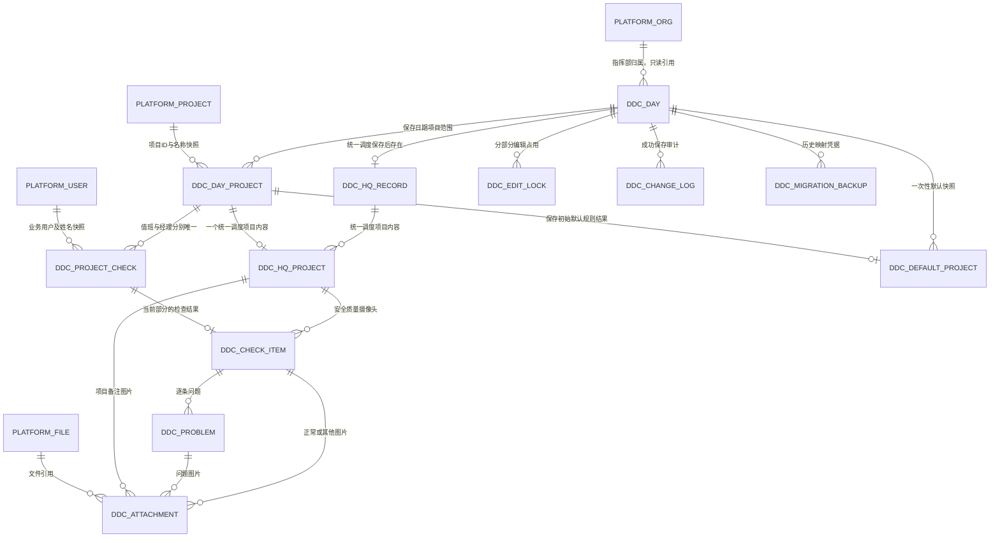

# 每日调度检查数据库逻辑设计

> **基线说明（2026-11-04）：** 本技术方案按旧Markdown PRD编制，尚未按[现行Word PRD v1.0](../requirements/Daily_Dispatch_Check_PRD_v1.0.docx)完成复核；当日统一调度二态已按最新确认与原非空字段一致，其余审查事项见[核查清单D04/F01](../requirements/每日调度检查_PRD_v1.0_核查清单.md)。本轮不改DDL或执行建库，不能把此稿视为新Word已对齐方案。

| 项目 | 内容 |
| --- | --- |
| 版本 / 日期 | V1.3 · 研发交底评审版 / 2026-11-03 |
| 对齐需求 | [每日调度检查PRD V1.7](../requirements/每日调度检查需求文档_PRD.md) |
| 文档顺序 | 先阅读本逻辑设计，再阅读[MySQL物理设计](每日调度检查数据库物理设计_MySQL8.md)及[建表脚本](每日调度检查建表脚本_MySQL8.sql) |
| 平台约定 | MySQL 8.0、InnoDB、utf8mb4；模块内和跨模块均不建物理外键，应用约束＋事务＋索引 |
| 文档状态 | 设计建议已具体化，供研发评审；不表示已接入业务后端、已建库或已通过DBA评审 |

本版同步安质部调度人员选填、两类项目部新填写默认当前用户；保留逐问题图片必填约束，不增加实体或改变三部分保存归属。总表详情、项目部列表/抽屉和标记显示均复用既有日表/项目/独立部分关联。

## 1. 范围与外部数据归属

本模块只在工程指挥部层级使用。同一指挥部一个检查日期一张日表，日表保存当日项目关系；统一调度、项目部值班人员、项目经理三个部分分别保存，在详情中关联读取。

平台项目、组织、用户、文件均为外部已有主数据。本模块只保存其ID和必要名称快照，不创建替代的用户表、项目表、组织表或文件实体表，也不修改其归属、隐藏或账号启用状态。`hq_org_id`引用平台指挥部组织，`org_fid/org_fname`沿用平台组织路径，不引入新的多租户产品功能。

逻辑关系用“关联”表达，不代表SQL包含FOREIGN KEY。子表必须通过所属日表校验组织权限与父子归属，不能因为没有物理外键而省略这些检查。

## 2. 核心实体与关系

图中三种附件父级是互斥选择；检查结果的两个父级也是互斥选择，不能把Mermaid多条边理解为一行同时归属多个对象。两个项目人员部分最多各一行，不以“当前填写人账号”作为部分的唯一键。

### 2.1 实体职责

| 实体 | 业务/技术职责 | 唯一性或基数 |
| --- | --- | --- |
| `ddc_day` | 每日检查主记录 | hq_org_id＋check_date唯一 |
| `ddc_hq_record` | 已保存统一调度部分 | day_id唯一 |
| `ddc_day_project` | 日期与项目的保存关系 | day_id＋project_id唯一 |
| `ddc_hq_project` | 统一调度的项目级内容 | day_project_id唯一 |
| `ddc_project_check` | 值班人员或项目经理独立保存部分 | day_project_id＋part_kind唯一 |
| `ddc_check_item` | 结构化检查结果 | hq_project_id＋check_key唯一；project_check_id唯一 |
| `ddc_problem` | 具体问题明细 | check_item_id＋sort_no唯一 |
| `ddc_attachment` | 检查图片引用与归属 | check_item_id＋usage_kind＋sort_no唯一；problem_id＋sort_no唯一；hq_project_id＋sort_no唯一 |
| `ddc_default_project` | 首次调度默认值快照明细 | day_id＋day_project_id唯一 |
| `ddc_edit_lock` | 可续租的编辑占用 | resource_key唯一 |
| `ddc_change_log` | 独立部分保存审计与请求去重 | request_id唯一 |
| `ddc_migration_backup` | 历史导入备份与映射凭据 | batch_no＋source_record_key唯一 |

## 3. 轻量日表与三部分内容

### 3.1 生成日表不代表已经检查

生成时写入日表及当时纳入的轻量项目关系，保存项目名称快照。不要为每天每个项目预建三份空正文、空问题和空附件。`ddc_hq_record`和`ddc_project_check`可以在首次成功保存前不存在；不存在部分在前端表示未填，不表示0、正常或已完成。

初次保存时期望版本为0，插入版本1；再次保存使用所属部分独立版本。统一调度一份版本，值班/经理按“日期项目关系＋部分”各自一份版本，不能共用整日单一正文版本阻挡不同部分编辑。

### 3.2 项目范围与业务正文分开

`ddc_day_project`是当日关系，`inclusion_state=1`参与当日列表和详情；`is_unified`是最后保存的当日统一调度标记，不是项目信息管理的基础调度标签。

空白初始行可按PRD受保护移除，物理上只改`inclusion_state=0`，保留项目ID、名称快照供恢复。同日同项目唯一，恢复不新建第二条关系。历史查询按保存关系读取，不能联查今天的项目隐藏状态排除历史未填行。

`ever_submitted_content`为粘性保护，服务端依据最新保存及内容置为1，清空字段、取消调度或客户端传0不能抹去历史保护。删除保护仍须核验最新正文、附件及有效项目编辑占用，不能仅信一个前端标记。

### 3.3 首次默认值独立保存

默认快照头放在`ddc_day.defaults_initialized_at/by`，明细放在`ddc_default_project`。首次初始化须按PRD第5.4节区分当日与历史范围，并读取最新调度标签；初始化后取消重进仍读同一快照。没有任何默认选中项目时，也要写完成时间，不能用“明细为空”判断还没初始化。

默认正常和两项参会文字先生成未保存编辑副本，不能提前写成有效检查正文或保存时间；用户正式保存后才有业务结论。技术范围/快照版本不等于业务保存版本。

## 4. 检查分支、人员和图片

### 4.1 检查结果编码

| 编码 | 业务含义 | 存储规则 |
| --- | --- | --- |
| 0 / 无记录 | 未填 | 显示“--”，不得默认变正常或0 |
| 1 | 正常 | 项目部文字和1～9张图片必填；统一调度不要求额外说明/图片 |
| 2 | 发现问题 | 当前结果1～10条有效问题；每条文字1～500字、图片必填1～9张 |
| 3 | 其他 | 有效文字最多500字；项目部1～9张图片必填 |

人员履职只允许0、1、3，其他说明最多100字，没有发现问题选项。项目备注最多100字，整体备注最多500字。项目部正常说明沿用现有无固定业务字数上限规则，物理承载使用LONGTEXT，不能借建表擅加500字或截断内容。

`ddc_check_item`恰有一个父级：统一调度的项目内容，或一个独立项目人员部分。统一调度字段键为SAFETY、QUALITY、CAMERA；项目部字段键为PROJECT。父级、字段键和同日归属由应用验证，唯一索引防重复。

只存生效分支。编辑会话的其他分支临时输入不写入业务表；改变分支时同一事务替换当前结果所属的正文、问题和引用，不能操作其他检查或另一人员部分。老版本审计仅保留必要快照与文件引用，不保存大段图片二进制。

### 4.2 姓名不是操作权限

业务姓名保存系统用户ID及姓名快照，实际操作账号另存。值班/经理新填写均默认当前登录启用用户，编辑已有保存保留原业务姓名，不能改用项目关联经理。默认候选为当前项目启用账号，合法已选值补入回显；搜索目标可选全系统启用用户，含非本项目用户，保存不能再次用项目归属拒绝合法跨项目选择。调度人员选填；选择时只允许安质部及下级部门启用用户。原型全系统关键词搜索差异见GAP-05。

历史只有姓名时可以以`needs_user_binding=1`保留展示，不能按同名猜测账号。项目部每次新保存必须关联启用用户ID并解除待绑定标志。调度人员选填：有选择才校验部门及启用状态；没有选择（ID缺省/NULL/空白）时写`dispatcher_user_id=NULL`、`dispatcher_name_snapshot`为空字符串、`needs_user_binding=0`，同时清空旧关联及姓名，不把NULL解释为保留旧值。原型对应空字符串ID。历史只读、取消或失败保留姓名快照；成功重保存才按本次选择或清空更新，不删除原审计。主数据改名、停用或删除不会自动重写已存姓名。

### 4.3 附件归属

一条附件引用恰有一个父级：检查结果的正常/其他分支、某一条问题、某一项目备注。`usage_kind`必须与父级和生效分支相符。当前控件顺序1～9，问题顺序1～10；序号用于展示，附件关联依赖稳定问题ID。

统一调度与项目部发现问题时，每条问题都必须同时有有效描述及1～9张图片；另一问题、另一部分、已删除问题或未生效分支不能借图满足必填，不另设整部分总数9张上限。历史缺图记录保留读取，重新保存按当前规则逐条核验，不能因正文未变跳过。一个合法文件可被不同检查引用，不设全局文件唯一约束。

图片格式、单张5MB及媒体类型在服务端复核。数据库只保存文件ID、名称、媒体类型、大小和归属；缩略图及原图访问地址由已有文件服务按权限生成，不把本地data URL或短期签名URL当永久存储。

## 5. 约束如何落实

| 约束 | 数据库落实 | 应用/事务落实 |
| --- | --- | --- |
| 指挥部＋检查日期唯一 | `uk_ddc_day_org_date` | 服务端业务时区、作用域鉴权与幂等生成 |
| 同日项目唯一且可恢复 | `uk_ddc_day_project` | 保存名称快照，受保护软移除/恢复 |
| 值班与经理独立 | `uk_ddc_project_part` | 独立版本、独立编辑令牌、写入白名单 |
| 检查结果不重复 | 两个父级唯一索引 | 两父级恰一非NULL、字段键匹配、同日归属 |
| 问题/图片稳定顺序 | 所属父级＋顺序唯一索引 | 条数、文字、格式、分支及每条问题至少1张图片校验 |
| 当前编辑只有一个持有人 | `uk_ddc_lock_resource` | 原子申请/续期/释放，令牌与服务端时间检查 |
| 请求重试不重复保存 | `uk_ddc_submit_request` | 同账号、资源与规范化payload_hash比对 |
| 没有物理外键也无孤儿 | 父级定位索引 | 同事务创建/更新/移除，写入前及迁移后检查关联 |
| 历史不随当前隐藏状态消失 | 保存日期项目关系 | 查询不以现项目隐藏过滤，不用当前主数据重建历史 |

上表中的条数、分支互斥和组织归属不能靠普通索引独立保证，必须有后端验证及故障回滚用例。数据库可空用于未保存或历史迁移，并不自动放宽PRD的新保存必填。

## 6. 保存与并发事务

### 6.1 统一保存顺序

服务端鉴权和请求形状校验后，开启短事务；按固定顺序锁定日表、涉及的日期项目关系、编辑占用行、所属部分，再处理检查/问题/附件/审计。三个填写部分的长时编辑占用仍独立，短事务中对共享日表的锁用于保护范围和最近时间，不把整张表变成同一业务编辑锁。

1. 若`request_id`已有相同账号、资源和载荷的成功审计，返回原版本回执，不再次保存；同请求ID不同内容拒绝，不泄露其他账号结果。
2. 核验编辑持有人、token、lease_version及expires_at，并对所属部分版本做原子比较；无有效占用或旧版本不得写入。
3. 统一调度按显式增加/移除操作合并最新范围；scope_version变更不等同正文版本冲突，能安全合并的新增行保留，无法安全处理时返回冲突，不能把旧完整数组覆盖新关系。
4. 替换当前部分白名单字段、生效分支的问题和附件，拒绝错日/错项目/其他部分ID。值班/经理只更新自己的部分；统一调度不包含people正文。
5. 所属部分版本＋1，保留首次时间，更新最近保存时间；日表`last_submitted_at`取三部分成功时间的最大值。
6. 同事务写成功审计和请求去重回执，按令牌释放自己的占用，提交事务；任一步失败全部回滚，前端保留当前未保存输入。

`request_id`重试检查必须在任何可能产生重复业务写入前生效；唯一键并发冲突后回查并核对同一请求，不把唯一键异常当保存成功。保存回执返回所属部分版本与实际保存时间，列表更新通过重新读取摘要完成。

### 6.2 占用、范围初始化与移除的竞态

统一调度资源为HQ:dayId；项目部分为DUTY/MANAGER:dayProjectId。资源行释放后保留，持有人/token/到期置空，lease_version再次占用递增；旧客户端不能释放新占用。

申请项目占用、范围初始化和关系移除遵循相同的日表/项目关系锁定顺序。初始化检查有效项目占用时不能读到竞态旧值；已有有效占用的空白行继续保留。租约时长和续期间隔由研发按平台机制评审，120秒/30秒仅为当前本地原型参数。

### 6.3 项目/文件服务不在本地事务中

外部用户、组织、项目和文件取数应在合适的调用边界完成，再在事务内核验版本或有效引用；不能持数据库锁等待用户操作或长时间上传。失败不编造空项目集、默认正常或人员ID。文件先上传并获合法引用，业务事务成功后转有效关联；失败临时文件回收遵循已有文件服务规则，不误删其他有效引用。

## 7. 台账摘要与详情查询

日记录先按组织权限和可选日期筛选、稳定倒序分页，再只聚合当前页需要的项目/结果/问题数量。返回当前页摘要、完整匹配总数及必要全范围问题合计；不能为了十行摘要把全部历史正文和图片传给前端。完整日表另按日期/记录ID读取。

| 值 | 计算口径 |
| --- | --- |
| 当日项目总数 | inclusion_state=1的关系数，包含保存的空白行 |
| 统一调度项目数 | 无统一调度保存为NULL；已有统一调度保存时统计active且is_unified=1的关系，可为0 |
| 安全质量问题数 | 仅active统一调度项目已保存HQ的SAFETY＋QUALITY有效问题；有问题取条数，无问题但任一明确正常取0，否则NULL |
| 摄像头问题数 | 同上独立取CAMERA；不能借安全/质量正常变0 |
| 五类状态 | HQ三类看已保存统一调度选中项目；值班/经理各看当日active关系的本部分保存，不合并 |
| 状态优先级 | 发现问题＞其他＞正常＞未填。枚举2/3/1不是优先级数值，禁止直接MAX(result_type) |
| 范围问题合计 | 对完整匹配日集合中的有效整数求和，全为NULL则NULL，不能只加当前页 |
| 最近更新时间 | 三部分成功保存时间最大值；生成、初始化、只读、补行不参与 |

首版不额外建立第二套可写摘要表。若后续性能评审采用缓存/派生表，必须明确与三部分保存的事务一致性及重建验证，不能让缓存成为另一份业务正文。

查询条件为空不删除或生成日记录。日期比较使用DATE和包含边界，不经浏览器时区转换。稳定排序使用check_date DESC, id DESC；同一次接口的记录/总数/合计需一致读，跨页集合变化与查询快照策略按接口设计评审，不能仅靠次级排序承诺任意并发下不重复。

## 8. 历史迁移与保护

迁移不是把前端IndexedDB的days/locks/logs/meta照搬成生产四张表。保留原始导出包及校验摘要，通过迁移凭据记录映射；生产编辑锁重新按平台服务生成，不迁移旧浏览器锁。

- 旧履职√仅按已确认映射转正常；字符串问题转逐条结构；项目部旧自由说明及附件转其他，不按关键词猜结论。
- 项目关系和名称来自原日期保存范围，包括当前隐藏的未填行；不把今天项目列表当历史范围重建。
- 缺业务用户ID保留姓名并标记待绑定；项目部再次保存须选有效用户，调度人员可重选安质部启用用户或留空保存并同时清空ID/姓名及待绑定标志；不能随便匹配同名账号。历史实际操作账号无法核实时允许保留NULL和已知姓名快照，来源留在迁移凭据中，不用导入人冒充原操作人；新保存实际操作账号必须来自真实登录态。
- 附件原归属能确定才迁入，无法确认时保留原备份并进入技术映射核对，不把所有图片塞给某一条问题。
- 导入前后核对日期数、项目关系、三部分内容、有效问题数、附件归属和NULL/0；相同日期已有内容不得被重复导入覆盖。

## 9. 研发评审与验收

研发需评审平台组织/用户/项目/文件的真实接口及ID规范、主键生成、锁服务与令牌、任务失败补偿、附件配额、审计备份保留和实际数据规模的执行计划。这些是技术方案/平台对接事项，不一概退回产品确认；若选型会改变历史项目范围、必填条件、可编辑范围或数据保留含义，必须再进行产品规则评审。

至少完成：重复日生成不重复；空快照取消重进不重置；历史隐藏未填行保留；项目部有效编辑时不被范围调整移除；两部分并发保存不覆盖；错日/错部分ID拒绝；旧版本/旧令牌拒绝；失败事务无半条正文/孤儿附件；相同请求只产生一次版本/审计；问题/图片上限和跨部分不借图；列表NULL/0/条数及范围合计一致；迁移备份可核对。

当前交付提供逻辑模型、物理字段及DDL静态校验，不等于已在真实MySQL实例完成建表、并发或性能验收。物理约束、索引及技术评审清单见下一份文档。

### 本轮保存与填写准入约束

保存成功即形成有效结果；first_submitted_at、last_submitted_at及submit相关表/方法沿用历史命名，字段/索引结构不变。进入统一调度填写前必须按组织＋检查日期＋统一调度资源原子申请占用，失败返回占用反馈，不开放填写页；其他日期及项目部两个部分独立。只读详情不占用。返回/取消确认放弃后释放自己的令牌，保存成功同事务写正文/审计并释放，失败不丢输入。

正式服务端应核验刷新恢复所携原会话令牌、持有人及旧会话有效性，不能只凭相同用户ID接管活跃会话；恢复需原子更换令牌/租约版本，旧令牌不能再写入或释放新占用。断线回收、心跳及跨设备可靠性由正式服务端实现，原型浏览器存活证明不替代该机制。
