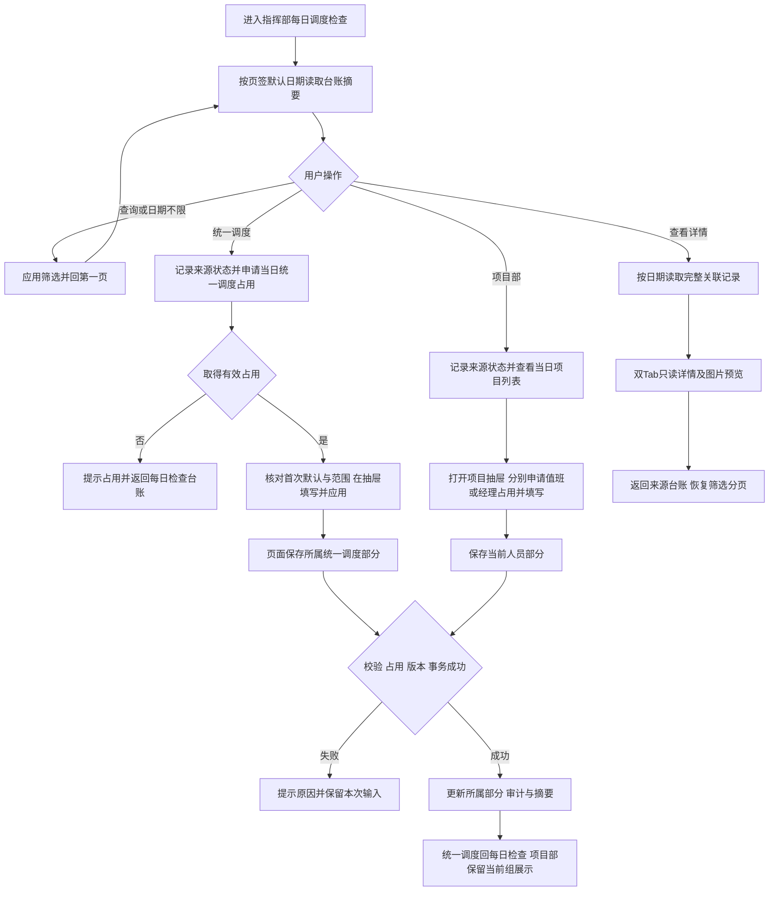
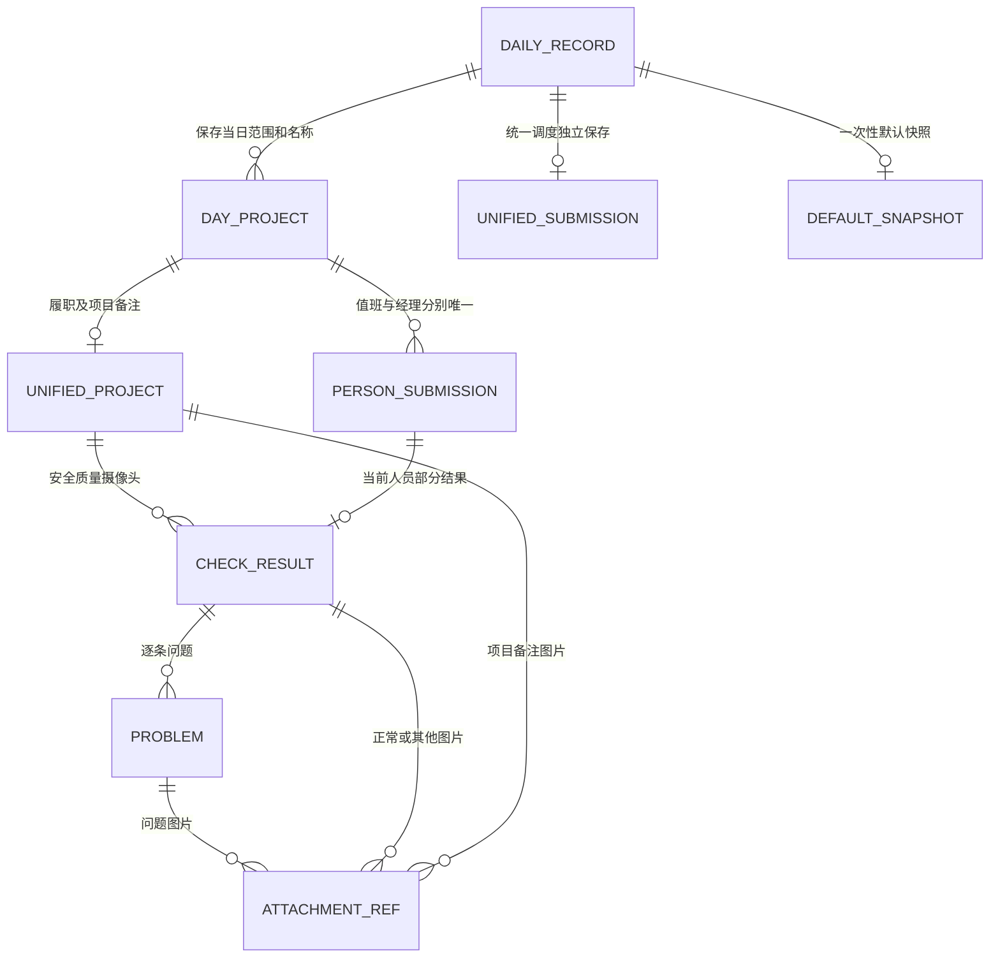
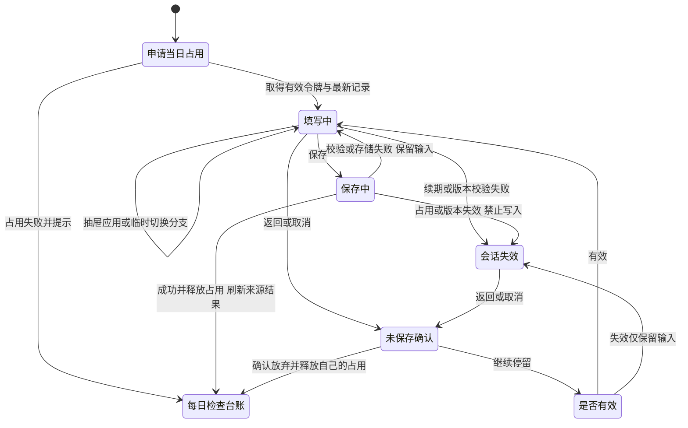

# 每日调度检查需求文档（PRD）

> **现行业务依据（2026-11-04）：** 以用户指定的[Word PRD v1.0](Daily_Dispatch_Check_PRD_v1.0.docx)为准，详见[差异与字段核查](每日调度检查_PRD_v1.0_核查清单.md)。本文件保留原版本内容及已有改稿，作为旧基线/原型参考，不表示已与新Word完全对齐。

| 项目 | 内容 |
| --- | --- |
| 所属系统 / 模块 | 深圳机场工程建设一体化智慧管控平台 / 调度后台管理 → 每日调度检查（会议记录之后、每周值班表之前） |
| 文档版本 / 日期 | V1.7 · 研发交底评审版 / 2026-11-03 |
| 产品定位 | 工程指挥部内部业务管理功能，沿用已确认的L3模块级范围 |
| 业务基线 | 用户在本会话明确确认的规则及当前源码原型；最新明确要求优先 |
| 原型核对基线 | 627c68c及本轮保存/占用/路由修订；真实跨设备占用等正式后台能力继续单列 |
| 评审状态 | 可用于研发交底和技术设计评审，不表示已评审通过、已上线或真实后端已实现 |

**目录：** [1.文档说明](#prd-1) · [2.业务背景与用户](#prd-2) · [3.范围与对象](#prd-3) · [4.流程与关联](#prd-4) · [5.功能设计](#prd-5) · [6.权限与人员](#prd-6) · [7.异常与保护](#prd-7) · [8.接口要求](#prd-8) · [9.验收标准](#prd-9) · [10.交底与评审](#prd-10)

## 1. 文档说明与交底约定

### 1.1 本稿用途

本文描述研发应实现的本期业务行为：页面、字段、默认值、校验、统计、历史保护、权限、查询和保存边界。产品规则以正文为准；原型用于展示交互和当前实现，不以原型尚未完成的技术能力降低正式要求。

本稿按模块范围组织内容并连续编号，完整覆盖字段、流程、异常、权限、数据关系和验收。商业分析、市场指标及独立运营推广不属于本模块交底范围。

### 1.2 交底资料与阅读顺序

| 顺序 | 资料 | 用途 |
| --- | --- | --- |
| 1 | 本PRD | 产品规则、页面及可验收行为 |
| 2 | [原型符合性核对](每日调度检查原型符合性核对.md) | 逐项区分已对齐、原型差异和正式服务能力，不把未实现要求当已完成 |
| 3 | [数据库逻辑设计](../database/每日调度检查数据库逻辑设计.md) | 业务实体、保存边界、逻辑约束、并发和历史保护 |
| 4 | [数据库物理设计](../database/每日调度检查数据库物理设计_MySQL8.md)与[MySQL8建表SQL](../database/每日调度检查建表脚本_MySQL8.sql) | 字段、类型、主键/索引及落库方案，按平台不建物理FK约定 |
| 5 | [查询与加载方案](../query-and-loading.md) | 当前前端分页与正式分页/详情接口接入边界 |

原有两份功能说明作为语言和原型参考；发生冲突时以最新用户确认和本文为准，不把旧卡片视图、持久列偏好或旧人员选择当新增要求。署名、评审参与人、排期及发布窗口由正式评审/发布记录维护，不混在业务规则中作为空白产品问题。

### 1.3 当前原型和正式开发分别验收

现有应用是Vue前端＋浏览器IndexedDB模拟。已实现查询分页、详情读取、三部分独立保存、同浏览器占用演示、文档下载和页面字号；没有真实服务端每日任务、跨设备鉴权/锁、数据库表或文件服务。正式开发须按本文与数据库设计实现服务端能力，不能把本地构建/演示通过写成生产验收。

除原型差异外，本轮还核对了“历史日期首次统一调度初始化”的规则边界，见5.4及10.1的BD-01；此项未确认前不得自行选择可能删除历史空白行的实现。

### 1.4 修改记录

| 版本 | 内容 |
| --- | --- |
| v0.1～v0.4 | 源码整理、已确认业务规则、文档下载、查询分页/返回和14px内容字号；v0.4原文归档（来源工程资料：`../archive/每日调度检查需求文档_PRD_v0.4_2026-11-01.md`） |
| V1.0 | 连续编号，改为研发交底结构，明确正式目标及原型差异；拆分产品/技术/交付责任，新增逻辑/物理数据库设计和建表脚本 |
| V1.1 / 2026-11-02 | 两个页签默认区间及重置统一为含当天向前共30个自然日，明确起日减29天；保留清空不限和下级返回恢复 |
| V1.2 / 2026-11-02 | 三个选人字段的下拉候选复用系统“姓名（组织-岗位）”展示；选中后姓名、用户ID及保存边界保持原规则 |
| V1.3 / 2026-11-02 | 移除填写框下的历史姓名提示；旧姓名无用户ID也必须重新选取安质部启用用户，页面与仓储均校验，保留只读原记录 |
| V1.4 / 2026-11-02 | 按1103汇报问题记录调整：统一空值与状态样式、总表详情、缩略图、项目抽屉公共调度标记、项目部列表配独立填写抽屉、逐问题图文必填及固定填写入口。第5条仅本模块，第10条保留整行点击，见[修订对照](../revisions/2026-11-03-report-review.md) |
| V1.5 / 2026-11-02 | 根据本会话截图精简项目部抽屉：移除调度字段及单一Tab；两类分组独立折叠、标题实时显示编辑状态；统一调度保留无附加文字的勾选框，收紧顶部间距。见[抽屉修订](../revisions/2026-11-02-drawer-refinement.md) |
| V1.6 / 2026-11-03 | 安质部调度人员改为选填；项目部两类新填写均默认实际登录用户，支持跨项目默认值回显和保存，编辑保留已存姓名。同步逻辑/物理数据库设计和SQL字段说明。  补充统一调度取消返回每日检查台账及示例数据按当前规则补齐。 |
| V1.7 / 2026-11-03 | 业务操作统一称“保存”；同日统一调度先占用后进入，失败提示并返回台账；返回/取消确认未保存内容，保存成功回台账刷新；刷新丢弃未保存输入、已保存内容带出，唯一详情页独立只读。 |

## 2. 业务背景、使用对象与目标

### 2.1 业务背景

需要按检查日期记录各项目的统一调度检查、项目部值班人员检查及项目经理检查。各部分可以分别填写和修改，在一份详情中关联查看，既不能互相覆盖，也不能把默认正常、未填和已保存结论混为一谈。

每日检查用于看五类结果并进入对应日期；检查总表用于查表头、项目及两类问题数量。历史项目改名、隐藏，不能让已纳入当日范围的内容和空白行消失。

### 2.2 使用对象与业务姓名

| 对象 | 本期定位 |
| --- | --- |
| 可登录工程指挥部层级的账号 | 可以查看及进入两类填写入口；仍受本期数据范围、占用和字段所有权控制 |
| 安质部调度人员 | 统一调度记录中的业务姓名，限安质部启用账号 |
| 值班人员、项目经理 | 项目部两类记录的业务姓名，按6.3选择；不等同实际操作账号 |
| 项目信息/系统用户维护人员 | 在已有模块维护项目、调度标签、部门及账号关系，本功能不新增主数据管理页 |

安质部负责统一调度、项目经理负责两类项目检查是后续理想分工；本期不把该分工擅自实施为岗位入口限制。项目层级不提供本模块入口，不要求切换顶栏到项目后填写。

### 2.3 目标和使用场景

| 场景 | 使用结果 |
| --- | --- |
| 按日期查检查情况 | 五类结果范围和优先级正确；可查明细，不以正常表示全部完成 |
| 统一调度填写 | 抽屉应用只改草稿，页面统一保存统一调度，不回写项目部正文 |
| 项目部两部分填写 | 先看当日项目列表，再在项目抽屉内独立填写、保存/取消两类检查，姓名和图片分别校验 |
| 查询全部历史 | 清空日期表示不限，真实分页包含空白日表，历史隐藏未填行保留 |
| 下级返回 | 原筛选、页签、页码、条数和可恢复滚动不丢失，摘要读取最新保存 |
| 研发验收 | 以第9章可核实行为验收；性能和部署参数由技术评审给出，不编造效率百分比 |

## 3. 功能范围与核心对象

### 3.1 本期功能清单

| 编号 | 功能 | 对应设计 |
| --- | --- | --- |
| F-01 | 每日检查状态台账 | 5.1 |
| F-02 | 统一调度检查填写 | 5.2 |
| F-03 | 项目部检查列表与独立填写抽屉 | 5.3 |
| F-04 | 当日完整只读详情与双Tab抽屉 | 5.5 |
| F-05 | 检查总表、详情入口、问题数和范围合计 | 5.7 |
| F-06 | 日表生成、项目范围与一次性默认 | 5.4 |
| F-07 | 结构化字段、人员及图片 | 5.6、6.3 |
| F-08 | 独立保存、占用、版本及历史保护 | 5.8 |
| F-09 | 历史结构与附件迁移 | 5.8、数据库逻辑设计第8节 |
| F-10 | 原型说明和多文档下载 | 5.9 |
| F-11 | 日期不限、分页、摘要/详情分读与返回恢复 | 5.10、8 |

### 3.2 核心业务对象

| 对象 | 含义和唯一性 |
| --- | --- |
| 每日主记录 | 指挥部＋北京时间检查日期唯一，一天一张；可没有任何检查正文 |
| 当日项目关系 | 日期＋项目唯一，保存项目ID、名称快照和当日范围，不等于当前全部项目 |
| 统一调度部分 | 一日一份已保存内容，含表头、项目检查/备注、标记、整体备注及范围变更 |
| 项目部部分 | 日期＋项目＋值班/经理分别唯一，各自姓名、内容、图片和版本 |
| 检查结果/问题/附件 | 结果有当前分支，问题逐条描述，图片明确归属，不合并成无归属总附件 |
| 首次默认快照 | 仅用于再次进入未保存编辑时恢复初始默认，不是已保存业务结论 |
| 编辑占用和审计 | 保护所属部分并记录实际操作；不新增整单业务状态或前台日志页 |

### 3.3 本期不扩展

不提供业务日表/总表/ZIP导出、Ctrl+V图片粘贴、批量填写、审批、催办、强制填报、整单确认完成、日期锁定、整月日历、整改闭环、排名、跨日去重及实时协同。不恢复日期卡片/列表切换、每日列设置或列偏好长期记忆。

### 3.4 已确认的总原则

1. 纳入当日范围、基础调度标签、当日统一调度标记分开保存。
2. 默认值、抽屉应用、初始化、只读和补项目都不是业务保存；成功保存才更新有效结果及业务时间。
3. 三部分独立保存、分别占用，详情只读关联同一批数据，旧数组不能覆盖后来新增项目关系。
4. 部分项目未填不抹去已有结论；“--”“正常”“0”分别有含义，不新增整单完成判定。
5. 业务日按北京时间，完整日期范围含首尾；空日期不限制范围，不能扩大权限。
6. 数据库/接口的实现细节可以由研发适配平台，不能改变以上业务边界和已确认人员/图片规则。

## 4. 业务流程与数据关联

### 4.1 操作流程

### 4.2 业务关联

附件父级互斥、三部分版本及物理约束详见数据库设计。平台用户、项目、组织、文件为外部既有主数据，不在本模块重复维护。

### 4.3 单一填写部分的编辑会话

统一调度保存成功直接回每日检查台账，返回/取消经未保存确认后退出；项目部组内取消恢复该组已保存展示。此图是单部分编辑会话，不是整日“待填/进行中/已完成”状态机。只读不占用，不同部分可同时编辑；保存/取消只处理自己的会话。

## 5. 功能设计

### 5.1 每日检查

**操作步骤：** S1进入【每日检查】；S2按检查日期查询；S3选择统一调度检查、项目部检查或查看详情。

**查询与展示条件**

| 项目 | 类型 / 默认值 | 规则 |
| --- | --- | --- |
| 检查日期 | 日期范围，默认最近30个自然日（含当天） | YYYY-MM-DD业务日期，完整范围含首尾；空值表示日期不限，仍点击【查询】生效，部分缺失才提示补齐。 |
| 排序 | 检查日期倒序 | 本地以唯一日期键稳定排序；正式接口另加稳定唯一字段，当前不新增表头排序操作。 |
| 分页 | 默认每页10条，可切10/20/50 | 实际总数、翻页、跳页；查询、普通刷新和改条数回首页。下级返回先刷新，再恢复原有效页码和条数；超界修正。 |
| 空结果 | 暂无符合条件的记录 | 不自动按查询范围生成虚拟行，也不提供手动补建按钮。 |

**列表字段**

| 字段 | 取值与展示 | 可修改 |
| --- | --- | --- |
| 检查日期 | 一天一行，固定在左侧 | 否 |
| 人员履职 | 当日已保存统一调度中，已勾选项目的人员履职结果 | 否 |
| 安全质量检查情况 | 同一范围内安全、质量结果合并聚合 | 否 |
| 摄像头检查情况 | 同一范围内摄像头结果聚合 | 否 |
| 项目部值班人员检查情况 | 当日全部已纳入项目中，已保存的值班人员结果 | 否 |
| 项目经理检查情况 | 当日全部已纳入项目中，已保存的项目经理结果 | 否 |
| 操作 | 统一调度检查填写、项目部检查填写，以及查看详情 | 通过入口另行编辑 |

**记录总数展示：** 每日检查工具栏的“共 x 条记录”与检查总表的问题合计使用同一套摘要样式：正文14px、常规文字颜色，数字加粗并使用主题色；保留当前筛选范围的完整记录总数，不按当前页条数显示。无匹配时显示“共 0 条记录”；加载失败仍显示失败提示，不用0条替代失败。

**操作按钮**

| 操作 | 行为与反馈 | 适用条件 |
| --- | --- | --- |
| 查询 | 应用完整范围或日期不限；部分缺失/无效范围提示，原查询不变。 | 当前页签 |
| 清空检查日期 | 仅取消日期限制，点击既有【查询】后生效；保留其他条件及全部历史数据。 | 当前页签 |
| 重置 | 恢复最近30个自然日（含当天）并查询；不与清空日期混用。 | 当前页签 |
| 刷新 | 重新读取数据；读取中显示加载反馈，异常显示原因。 | 当前页签 |
| 统一调度检查填写 | 进入对应日期的统一调度填写页；无论有无保存，入口固定显示“填写”。 | 指定日期记录存在 |
| 项目部检查填写 | 进入对应日期的项目检查列表，再打开项目抽屉；入口固定显示“填写”。 | 指定日期记录存在 |
| 查看详情 | 进入该日期完整只读详情。 | 指定日期记录存在 |

每日检查操作列右侧固定、保持280px，表头与正文在各横向滚动位置均不显示操作列阴影；其余六个数据列最小宽度仅各缩小5～10px，避免临界宽度下多余溢出，窄容器仍可横向滚动。两个填写入口在上方同排，查看详情单独一行。当前没有日期卡片、视图切换、每日列设置和每日问题合计；列表不以行点击替代上述入口。

**结果聚合规则**

| 编号 | 规则类型 | 规则 |
| --- | --- | --- |
| R-D01 | 业务规则 | 每日五类结果分别计算；前三类范围为已保存统一调度内勾选的项目，后两类范围为当日全部已纳入项目。 |
| R-D02 | 约束 | 人员履职只含正常/其他，按“其他→正常→--”取当前存在的最高优先结果。 |
| R-D03 | 计算 | 安全质量、摄像头、值班人员、项目经理分别按“发现问题→其他→正常→--”取最高优先结果；发现问题须有有效问题文字。 |
| R-D04 | 验收规则 | 部分项目正常、其他项目未填写时，可以展示正常；该结论不代表所有项目已填写。存在其他时优先展示其他，不并列多种状态。 |
| R-D05 | 约束 | 值班人员与项目经理独立聚合；不合为一列，也不将两列结果互相提升或降低。 |
| R-D06 | 业务规则 | 仅未保存的默认值不进入聚合；旧自由文字不按关键词识别为正常或发现问题。 |

例如：同一维度一个项目正常、一个项目未填，列表显示正常；一个正常、一个其他，显示其他；只要该维度出现有效问题，显示发现问题。值班人员有问题、项目经理正常时，两列分别显示“发现问题”“正常”。

### 5.2 统一调度检查填写

**操作步骤：** S1从日期记录进入并取得统一调度编辑占用；S2核对基本信息和项目范围，在抽屉完成当前项目填写并应用；S3在页面【保存】统一生效，或【取消】放弃本次编辑。

进入填写入口前必须取得该检查日期的统一调度有效占用，取得后才展示填写表单。同一日期仅一个有效填写会话，不同日期可分别填写；项目部两类仍独立保存和占用。被占用时弹出提示条并返回【每日检查】台账，保留原查询和有效分页；不以填写页充当只读展示，查看须由台账【查看详情】进入唯一的【COC调度会检查记录表详情】。

点击顶部【返回】或底部【取消】均弹出【未保存内容】：【继续填写】保留输入及占用；【确认放弃】清理本次未保存输入、释放自己的占用并返回每日检查台账。已经进入填写会话即执行该确认，不以是否改过字段绕过。成功【保存】后释放占用、直接回每日检查台账，不再弹放弃确认；按原日期（含不限）、条数、有效页码及可恢复滚动重新读取最新摘要。无有效来源时采用每日检查默认条件。

页面刷新或标签页内存丢失后，丢弃未保存输入，不自动恢复草稿；重新申请占用，成功则重新读取当日已保存内容，未保存过的日期按空白及既定默认值初始化。不能把已保存内容清空成新表。有其他有效占用时提示并返回台账；同账号的活跃另一标签也不能抢占。异常退出后由会话及租约机制回收，正式系统必须由服务端核验。

**基本信息字段**

| 字段 | 类型 | 必填 / 默认值 | 限制与联动 | 修改范围 |
| --- | --- | --- | --- | --- |
| 检查日期 | 日期展示 | 入口日期，只读 | 不通过修改表头切换检查日期 | 只读 |
| 重点调度部门 | 文本 | 选填，初始空 | 最多200字；与项目调度标签无关 | 统一调度 |
| 参会情况 | 文本 | 选填，首次未保存编辑默认“参会” | 最多200字；重新编辑不覆盖已保存值 | 统一调度 |
| 安质部调度人员 | 可搜索、可清空的用户单选 | 选填；初始为空，不默认他人 | 留空允许保存；选择时必须是安质部及下级部门启用用户，保存ID与姓名快照。清空后两项一并置空；旧记录未关联用户ID时下拉留空，不附加历史姓名展示 | 统一调度 |
| 各部门参会情况 | 文本 | 选填，首次未保存编辑默认“参会” | 最多200字；重新编辑不覆盖已保存值 | 统一调度 |

表头按两列、两行组织，左侧重点调度部门/安质部调度人员，右侧两项参会情况；标签与内容对齐。安质部调度人员为选填，不显示必填标记；其余表头仍按原选填规则。

**项目检查汇总表**

| 字段 / 分组 | 展示及编辑方式 |
| --- | --- |
| 项目名称 | 左侧固定，按当日名称快照显示；名称本身不在此修改。 |
| 当日统一调度 | 编辑时为独立勾选框，只读时显示是/否；决定统一调度聚合和问题统计范围。 |
| 人员履职 | 正常/其他；详情在项目抽屉集中填写。 |
| 安全、质量、摄像头检查情况 | 三个独立字段，均为正常/发现问题/其他。 |
| 项目备注 | 最多100字文字及可选图片；与整日整体备注分别保存。 |
| 项目部值班人员检查情况 | 两层表头，下分姓名、项目检查情况、检查情况截图；只读关联。 |
| 项目经理检查情况 | 同上，单独分组；只读关联。 |
| 操作 | 当前编辑时显示填写、删除项目；非编辑时显示查看详情。 |

表格上方显示【项目总数】【当日统一调度项目数】。项目总数为当前范围的行数；编辑中的调度数量是预览，保存前不改变台账有效统计。未勾选统一调度的项目仍可保留检查内容。

项目表默认每页10项，可切10/20/50；分页只改变当前显示，范围、校验和保存仍覆盖整张当日项目清单。项目名称和操作列固定，宽表可横向滚动。

填写中的人员履职、安全、质量、摄像头分组在标题行同步展示当前状态，位置与只读详情一致，靠近折叠图标；发现问题显示当前有效问题条数。状态取编辑副本，切换选项即更新，收起后仍可见，不意味着已经保存或改变台账统计。

**项目抽屉字段**

| 字段 | 选项 / 默认值 | 必填与长度 | 图片 |
| --- | --- | --- | --- |
| 人员履职 | 正常/其他；符合一次性默认条件时带出正常 | 未选择可留空；选择其他时文字必填，最多100字 | 不单设图片输入 |
| 安全检查情况 | 正常/发现问题/其他；默认规则见5.4 | 正常不要求补说明；发现问题1～10条，每条文字必填、最多500字；其他有效文字必填、最多500字 | 发现问题每条必填1～9张，单张不超过5MB |
| 质量检查情况 | 同安全，独立保存 | 同上 | 同上 |
| 摄像头检查情况 | 同安全，独立保存 | 同上 | 同上 |
| 项目备注 | 多行文字，初始空 | 选填，最多100字 | 选填0～9张 |

人员履职没有“发现问题”选项。统一调度的正常、其他分支当前没有额外截图填写入口；已有有效说明或附件在只读内容中继续保留展示。

**操作与保存**

| 操作 | 触发与行为 | 保存影响 |
| --- | --- | --- |
| 添加项目 | 从当前未隐藏且未纳入的项目中选择，详见5.4 | 加入当前未保存表单，页面保存时保存范围变更。 |
| 勾选当日统一调度 | 改当前行标记，不自动填正常、不清空已有输入 | 页面保存后生效。 |
| 行点击 / 填写 | 打开同一个项目抽屉，按钮不重复触发行点击 | 不直接保存。 |
| 应用到当前表单 | 校验当前项目；失败定位问题，成功提示“已应用到本页，页面保存后生效” | 只回填页面表单；不是保存成功。 |
| 删除项目 | 先核对真实记录保护，再二次确认；仅移除当前日期范围 | 范围变更随页面保存生效。 |
| 页面保存 | 校验表头及全项目字段；显示保存中状态，成功提示“统一调度检查已保存” | 保存统一调度整个部分并释放占用，回每日检查台账刷新来源结果；失败留在填写页保留输入。 |
| 页面返回 / 取消 | 弹【未保存内容】，继续填写则保留输入和占用，确认放弃才释放并回每日检查台账、恢复来源查询和有效分页 | 保留已保存正文和其他部分；释放失败保留编辑并提示。 |
| 刷新内容 | 重新读取关联数据，编辑中的统一调度表单保留 | 不把查询到的项目部值回写。 |

**业务规则**

- **R-U01** 保存范围仅含基本信息、当日调度标记、统一调度项目检查、项目备注、整体备注及显式范围变更；项目部姓名、正文、图片不参与统一调度写入。
- **R-U02** 整体备注位于页面底部，选填、最多500字，与项目行备注分别保存。
- **R-U03** 首次进入时取得初始化快照；只有正式保存才更新有效结果、时间和版本。
- **R-U04** 抽屉关闭时，如有未应用修改，提示确认放弃或继续填写；页面返回、路由切换时如仍在编辑，提示处理未保存内容。不提供持久化草稿或实时协同。
- **R-U05** 可以只填写部分项目，也可以明确保存零个统一调度项目；不因未勾选或未填写其他项目而新增强制任务。

### 5.3 项目部检查填写

**操作步骤：** S1进入指定日期，查看当日项目及两类检查情况；S2点击项目行或【填写】打开项目抽屉；S3在值班人员或项目经理组点击【填写/编辑】，独立保存或取消当前部分；S4关闭后继续其他项目。

页面沿用统一调度填写的标题、检查日期和检查情况表格，仅保留【检查情况】。不展示基本信息、整体备注或原项目单选区。项目人员可负责多个项目，先用列表核对各项目的姓名、结果、截图，再进入具体项目填写。

**项目列表**

| 字段 / 操作 | 展示与行为 |
| --- | --- |
| 项目名称 | 使用该日期保存的名称快照，左侧固定；当前已隐藏的历史未填行仍保留。 |
| 值班人员检查情况 | 两层表头，下分姓名、项目检查情况、检查情况截图；未填显示“--”。 |
| 项目经理检查情况 | 同上，独立展示已保存内容。 |
| 操作 | 固定【填写】，整行点击进入同一个项目抽屉；按钮及图片点击不重复触发行点击。 |
| 项目总数 / 两类已填项目数 | 项目总数为当日范围行数，两类分别按已有有效保存的项目数计算，不合成整单完成状态。 |
| 添加项目 | 选择当前未隐藏且未纳入的项目，按ID补入共享行并打开抽屉；不保存任何检查正文或业务时间。 |
| 分页 | 默认每页10项，可切10/20/50、翻页和跳页；只改变显示，不改范围。打开、保存或关闭抽屉后保持原有效页码和条数。 |

列表不展示当日统一调度、人员履职、安全/质量/摄像头检查、项目备注列，也不提供删除项目；项目部抽屉也不显示该字段。项目部入口不修改统一调度字段和范围删除规则。

**项目抽屉与字段**

抽屉固定显示项目名、检查日期，不显示当日统一调度字段，不设置Tab。直接按【项目部值班人员检查情况】【项目经理检查情况】分别分组，可独立折叠和展开，沿用统一调度抽屉的字段分组、问题列表和图片组件。两组各自编辑，允许一组查看、另一组填写或同时编辑，不提供两组一起保存。组标题显示当前正常/发现问题/其他状态；编辑中随选择实时更新，查看时取已保存内容，正文不重复显示同一状态标签。

| 字段 | 类型 / 默认值 | 必填与限制 | 修改与联动 |
| --- | --- | --- | --- |
| 检查日期 / 项目 | 入口日期及所选项目，只读 | 日期记录、项目关系须存在 | 切换项目前处理未保存内容。 |
| 姓名（两个部分各一项） | 可搜索系统用户单选；**两部分均默认当前登录用户** | 保存必填，必须关联某个用户ID | 默认列项目启用账号，搜索全系统启用用户，可选择非本项目用户保存。 |
| 项目检查情况 | 正常/发现问题/其他；首次启动该部分默认正常 | 保存必选 | 会话内切换分支保留输入，重新编辑不覆盖已保存值。 |
| 正常检查说明 | 可编辑多行文字，默认“现场施工、监理管理人员在岗在位，施工正常” | 有效文字必填；不新增固定业务字数上限，不截断原说明 | 不覆盖另一部分。 |
| 正常截图 | 当前正常分支的图片控件 | 必填1～9张，单张不超过5MB | 与当前部分、当前分支关联。 |
| 发现问题 | 逐条问题、逐条图片 | 每部分1～10条；每条文字必填、最多500字；**每条图片必填1～9张**，单张不超过5MB | 每条独立校验，不另设全部问题图片的总张数上限。 |
| 其他说明 / 截图 | 多行文字及当前分支图片控件 | 有效文字必填、最多500字；截图必填1～9张、单张不超过5MB | 与当前部分、当前分支关联。 |

**姓名规则：** 两部分新填写均默认当前登录的启用系统用户，不因其不属于当前项目而留空；不默认项目关联经理。编辑已保存部分保留原业务姓名，用户可手动改选。无搜索列当前项目启用账号，并补入合法已选用户供回显；关键词搜索全系统启用账号，合法跨项目选择可回显和保存，不因恢复项目默认候选而清空。用户必须有效且启用，不允许自由姓名保存；选择不修改用户项目归属。原型已对齐两类默认、跨项目已选值回显及保存，关键词全系统搜索尚有差异，见GAP-05。

**独立操作与保护**

| 操作 | 行为与反馈 | 保存边界 |
| --- | --- | --- |
| 填写 / 编辑 | 申请日期+项目+当前人员部分占用，在原分组展开表单；原分组已收起也自动展开 | 不锁住另一部分，已保存可用【编辑】修改。 |
| 保存 | 校验姓名、当前分支及每条图片，显示保存中；成功后更新当前分组和项目列表摘要 | 只保存当前部分，不要求统一调度或另一部分先填写。 |
| 取消 | 放弃当前部分输入，恢复已保存展示并释放占用 | 不清空另一部分或其未保存输入。 |
| 关闭 / 切换项目 / 返回 | 有未保存部分时确认放弃或继续填写；处理中不能离开，确认后释放当前占用 | 已成功保存的其他部分和项目继续保留。 |
| 查看已保存内容 | 姓名、最近更新时间、实际检查内容及图片，空值“--” | 查看不占用、不改业务时间。 |

- **R-P01** 分组名称表示业务内容，不要求操作者本人就是该项目经理或值班人员；账号口径见第6章。
- **R-P02** 同一用户可依次填写两部分，也可选择不同业务姓名；两部分各自保存用户ID，实际操作账号另记。
- **R-P03** 每条问题必须同时具备有效描述和至少1张合法图片；另一条问题、另一部分或未选分支的图片不能抵扣。
- **R-P04** 删除最后一张图片后，在该问题附近提示“请至少上传1张检查情况截图”，阻止当前部分保存；删除整条问题后，剩余问题继续逐条校验。
- **R-P05** 历史缺图问题保留只读查看，重新保存按当前逐问题图文规则校验，不自动补图、丢弃正文或改变统计。
- **R-P06** 单部分超过36张提示加载与保存耗时，该提示不构成额外上限；每条9张、每部分10条仍适用。
- **R-P07** 折叠只隐藏当前分组正文，不清空姓名、描述、问题、图片，不保存或释放有效占用；展开继续填写。两组互不影响。点击填写/编辑或出现校验错误时展开对应组，操作按钮不同时触发折叠。

**字号与布局：** 列表和抽屉沿用本模块排版，项目部填写正文、字段/问题标题及表单内容保持14px；分组标题、编号、标签和辅助提示按现有层级，不修改全局主题。

### 5.4 项目范围、调度标签与首次初始化

**操作步骤：** S1北京时间00:00:00生成当天主记录并取初始项目；S2首次统一调度编辑取得有效占用后重读配置；S3按范围规则冻结一次性默认快照；S4保存前默认值只存在于编辑副本。

| 时点 / 操作 | 项目范围 | 调度标签与保护 |
| --- | --- | --- |
| 当天零点生成 | 读取当时未隐藏项目，保存唯一日期项目关系及名称 | 不预建三份空正文，不将默认值算保存 |
| 当日首次统一调度编辑 | 重新读取最新隐藏配置，补入新增/取消隐藏项目，移出符合条件的隐藏空白行 | 同次读取最新调度标签；已有内容、保存标记、附件或有效项目占用的行必须保留 |
| 历史日纯查询、详情或已初始化后的再编辑 | 读取原日保存范围，包括当前隐藏的未填行 | 不按今天隐藏配置反复筛掉历史行 |
| 历史日期尚未初始化、首次统一调度编辑 | 见10.1的BD-01：历史保留与首次范围重校存在待消歧边界 | 未确认前不得擅自将当日移除规则用于历史空白行；此项不是研发自行决定的技术参数 |
| 后续添加/项目部选择范围外项目 | 仅允许当前未隐藏且尚未纳入的既有项目，按ID补入/恢复 | 同日同项目唯一，恢复原关系名称快照，不重置一次性默认 |

**一次性默认：** 在可初始化范围内，读取最新标签开启的项目，默认勾选当日统一调度，并对尚无实际内容的履职、安全、质量、摄像头带出正常；参会及各部门参会默认“参会”。必须同时重读隐藏配置与标签，不能只更新隐藏而仍用零点标签。

初始化必须原子完成，并保留完成标记和项目快照。合法空快照也表示已经初始化；取消重进沿用同一快照，后续改基础标签、手动勾选/取消或新增项目不再次补正常。已有保存的正文和姓名不因默认值重置，旧已保存日表不回填。

**删除保护：** 仅未人工修改、未保存的系统初始行可二次确认移除。已有有效检查、保存标记、当日调度标记或附件不可通过清空/取消勾选绕过；还要核对其他入口新保存和有效项目编辑占用。删除只改当日范围，不删基础项目，不影响其他日期。

**两个添加入口：** 统一调度添加项目进入当前草稿，页面保存才保存范围；项目部添加范围外项目立即按ID补入共享行，随后取消填写不撤回关系，但补行不产生检查保存时间。统一调度旧数组保存必须保留后来补入的行。

**已确认示例：** 零点A未隐藏、标签关；当日首次填写时标签已开，则用新标签默认勾选/正常。零点后B新增或取消隐藏，首次当日填写可补入并按最新标签初始化。A当时已隐藏且空白、无有效占用时可移出；已有内容或有效项目占用时保留。历史日期首次情形单独按BD-01确认，不能与纯历史查询混用。

### 5.5 完整详情与项目抽屉

**操作步骤：** S1从每日检查或检查总表【查看详情】进入指定日期；S2查看基本信息、项目汇总及整体备注；S3点击项目行或【查看详情】，在双Tab抽屉查看具体内容和图片。

**上下文与字段展示**

| 区域 | 展示内容 | 操作边界 |
| --- | --- | --- |
| 页面标题 | 页面标题为【COC调度会检查记录表详情】，检查日期作为辅助信息 | 保留返回和刷新内容。 |
| 基本信息 | 当日已保存的四个表头字段 | 只读，空值“--”。 |
| 项目汇总 | 当日范围、名称、调度标记、统一调度检查、项目部两部分及图片缩略图 | 只读；操作列只提供详情，不新增/删除项目。 |
| 整体备注 | 当日已保存的整体备注 | 只读，空值“--”。 |
| 项目抽屉—统一调度检查情况 | 人员履职、安全、质量、摄像头及项目备注 | 当前入口下全部只读。 |
| 项目抽屉—项目部检查情况 | 值班人员、项目经理的姓名、最近更新时间、检查和图片 | 两部分均只读；统一调度填写入口下该Tab也只读。 |

**内容与弹出层交互**

- 表格摘要保持有限行高。正常展示轻量正常标签及实际说明；发现问题预览前两条有效问题，超出提示“另有N项…”；其他以浅灰背景标签配实际说明，未填写显示“--”。检查内容及截图列显示可点击缩略图，不再显示“图片N张”；多图用有限缩略图和余量入口查看，不渲染原图全集。
- 抽屉按字段分组，有实际正文或图片的内容默认展开，可点击标题收起/展开；问题按01、02等顺序展示全部有效文字及逐条图片。简单正常或未填不额外撑出空内容区。
- 填写抽屉的字段组也可展开/收起；校验有错误时自动展开相应区域，不能用收起状态绕过校验。
- 项目名、日期固定在顶部。统一调度及完整详情保留两个Tab，日期下、Tab外显示带图标的【当日统一调度】：编辑时只显示勾选框，不附加“纳入当日统一调度”文字；保留可访问名称，应用/页面保存边界不变；完整详情只读是/否。项目部入口不显示此字段，也不设置Tab。信息行与页签/首个分组紧凑相接，不叠加大块空白。本轮浏览器批注细化为：各入口检查日期行上内边距15px；项目部填写抽屉的日期行下内边距5px，统一调度/完整详情日期行下内边距0px；统一调度行上下内边距各8px，编辑和只读共用；左右内边距沿用桌面20px、480px及以下16px，不新增断点。中间内容滚动。常规宽度约视口30%，最小可读宽度360px，窄窗口最多视口减32px。
- 抽屉右上保留关闭按钮。只读时可点击遮罩或按Escape关闭；填写时不允许点击遮罩直接关闭，关闭有未应用修改的抽屉时给出放弃提醒。统一调度填写状态显示底部取消和【应用到当前表单】，项目部抽屉保留关闭及组内独立保存/取消。
- 图片可点缩略图预览，在预览弹窗内前后切换和关闭。只读状态不显示上传、移除图片、删除问题、应用或保存。
- 项目表保留整行点击打开抽屉；操作按钮、缩略图等独立处理点击，避免同时打开抽屉。仅本模块表格行悬停用主题浅色，与表头区分；不修改其他模块。
- 不用禁用表单铺满详情，也不以文字颜色作为能否编辑的唯一提示。颜色、字号和间距沿用现有后台及当前组件，不照搬旧说明的像素参数。

### 5.6 共用检查、人员选择与图片规则

**检查输入与分支**

| 场景 | 文字校验 | 图片校验 |
| --- | --- | --- |
| 统一调度人员履职—正常 | 无额外说明必填 | 无独立上传输入 |
| 统一调度人员履职—其他 | 去除首尾空白后有效，最多100字 | 无独立上传输入 |
| 统一调度安全/质量/摄像头—正常 | 无额外说明必填 | 无额外截图填写要求 |
| 统一调度安全/质量/摄像头—发现问题 | 每字段1～10条，每条有效文字、最多500字 | 每条必填1～9张，逐条校验，不可合用其他问题的图 |
| 统一调度安全/质量/摄像头—其他 | 有效文字必填，最多500字 | 无额外截图填写要求 |
| 项目部正常 | 有效文字必填，可修改默认说明 | 当前部分1～9张 |
| 项目部发现问题 | 当前部分1～10条，每条有效文字、最多500字 | 每条必填1～9张，逐条校验，不可合用其他问题的图 |
| 项目部其他 | 有效文字必填，最多500字 | 当前部分1～9张 |
| 项目备注 / 整体备注 | 项目备注最多100字；整体备注最多500字 | 项目备注0～9张；整体备注无单独上传控件 |

**共用交互**

| 操作 | 规则 |
| --- | --- |
| 选择发现问题 | 当前没有问题行时生成一条空问题，按问题1、问题2连续编号。 |
| 新增问题 | 紧接问题列表提供入口；达到10条时禁用，提示“最多添加10条问题”；删除后恢复。 |
| 删除问题 | 删除当前行并连续编号，同时移出该问题的图片归属与校验范围。 |
| 切换检查选项 | 当前会话保留其他分支输入；切回可以继续编辑。未选分支不参与当前校验、保存或统计。 |
| 上传图片 | 点击上传，支持jpg/jpeg/png/gif/webp/bmp/svg；单张不超过5MB，单控件最多9张；格式、大小或数量不符时提示。 |
| 删除图片 | 编辑时移除当前问题/字段所属图片，并重新校验必填；只读不提供删除。 |
| 预览图片 | 点击缩略图，支持上一张、下一张及关闭；无图片不预留空附件区。 |
| 人员候选展示 | 安质部调度人员、项目部值班人员、项目经理三个字段展开后，选项统一为“姓名（组织-岗位）”。复用系统现有组织/岗位解析，多岗位用顿号连接；缺组织或岗位时只显示已有信息。长内容省略展示，悬停可查看完整文字；不另列手机号。选中后输入框及记录仍显示姓名，保存用户ID和姓名快照，不将组织/岗位写入姓名。 |
| 人员搜索 / 清空 | 在现有下拉中搜索、选中或清空用户，不另设自由姓名输入；姓名和用户ID关联保存。 |
| 无候选 / 无匹配 | 区分基础用户或部门数据缺失、搜索词无匹配，给出相应提示；不以手填姓名绕过用户关联。 |

**R-C01** 所有问题均按有效文字条数计数，图片数量不等于问题数量。文字为空的问题不构成“发现问题”的有效明细，图片也不构成有效问题；描述和图片分别逐条校验。

**R-C02** 两个人员部分和三类统一调度检查分别计算上限；允许一个项目部部分有10条问题、每条9张图，不把所有问题图片合起来再限制为9张。浏览器实际容量及正式附件服务承载能力另见7。

**R-C03** 项目部首次保存校验后，修改当前表单继续更新对应错误提示；缺文字或图片在对应问题附近提示，缺图使用“请至少上传1张检查情况截图”。

**R-C04** 旧无图问题保留查看，重新保存当前所属部分时按新规则逐条校验，不能因内容未变跳过问题图片校验。

**R-C05** 当前不提供Ctrl+V图片粘贴、跨问题批量复制、附件打包下载和常用语模板管理。切换分支保留是当前会话的操作便利，不是已保存草稿。

### 5.7 检查总表与问题数量

**操作步骤：** S1切到【检查总表】；S2选择检查日期并查询；S3查看逐日字段、两类合计，按需临时选列；S4点击【查看详情】进入同一份当日只读详情。

**查询与列表**

| 项目 | 默认值 / 行为 |
| --- | --- |
| 检查日期 | 最近30个自然日，含当天；按北京时间的业务日期确定“今天”。 |
| 查询 / 清空 / 重置 | 完整范围或日期不限均可查询；清空不恢复默认，重置恢复最近30日并查询。与每日检查分别保留日期条件。 |
| 刷新 | 重新读取已保存记录，并恢复全部默认列。 |
| 排序与分页 | 检查日期倒序，默认10条，可切10/20/50；查询、普通刷新及改条数回首页。下级返回按来源恢复有效页码、条数和页签，实际按页展示。 |
| 列设置 | 当前停留期间可逐列勾选/恢复默认，日期固定显示，操作列固定且不参与列设置；关闭选择面板或仅查询日期不清空选择。再次进入总表页签、点击本页刷新或重载页面恢复全部默认列，不保存用户列偏好。 |
| 只读边界 / 操作列 | 右侧固定眼睛图标＋【查看详情】，进入该日完整只读详情；不提供填写或行内编辑，返回恢复总表查询状态。检查总表操作列保留按横向遮挡显示的阴影：右侧还有被遮挡内容时显示，滚到最右或全部列已显示时消失，表头与正文同步；不把该操作列阴影应用到每日检查。左侧检查日期沿用原有滚动规则。 |
| 范围合计 | 显示安全质量、摄像头问题合计，按完整筛选结果计算，不按当前分页计算。 |

**十个候选数据字段（另加固定操作列）**

| 字段 | 类型 / 来源与空值 |
| --- | --- |
| 检查日期 | 日期；固定显示。 |
| 重点调度部门 | 已保存统一调度表头；无有效内容“--”。 |
| 参会情况 | 同上。 |
| 安质部调度人员 | 已保存业务姓名；与操作账号分别记录。 |
| 各部门参会情况 | 已保存统一调度表头；无有效内容“--”。 |
| 当日统一调度项目数 | 已保存调度标记勾选数；未保存“--”，明确保存零个则为0。 |
| 检查项目 | 已保存调度标记对应的项目名称快照，按当日项目顺序排列；无内容“--”。 |
| 安全质量问题（项） | 统一调度范围内安全与质量有效问题数之和。 |
| 摄像头问题（项） | 同一范围内摄像头有效问题数。 |
| 最近更新时间 | 统一调度、任意项目值班人员或项目经理成功保存的最新时间；无保存“--”。 |
| 操作（固定，不属于候选数据列） | 眼睛图标＋【查看详情】，无论是否已有检查正文均可查看已保存日表。 |

列表单元格长内容允许换行并截断预览。仅表格内部滚动，筛选、合计与分页保持可用；不显示旧说明中的项目“值班01”字段。

**问题数量计算规则**

- **R-S01** 只统计该日已保存的统一调度部分，且只取勾选【当日统一调度】的项目。项目部两类问题以及未勾选项目的检查都不并入这两项数量。
- **R-S02** 安全质量问题数=该范围内安全有效问题条数+质量有效问题条数；摄像头问题数单独计算。不同项目、同项目不同字段按各自有效明细累计，不做跨日或跨字段去重。
- **R-S03** 某维度有有效问题则显示对应整数；没有问题，但存在明确正常结论则显示0；既没有问题也没有正常结论，则显示“--”。只有其他说明不产生0。
- **R-S04** 安全、质量任一存在正常且两者均无问题时，安全质量可为0；不能因此让尚无结论的摄像头也变成0。
- **R-S05** 部分项目未填写时仍按已保存有效内容统计，0不代表全部已填写；明确保存零个调度项目时，项目数为0，但问题维度仍可为“--”。
- **R-S06** 日期范围合计只累加各日有效整数；全部为“--”时合计仍为“--”。隐藏列、分页及切换显示不改变计算。
- **R-S07** 只有成功保存更新最近时间；只读查询、初始化、选项目补行、抽屉应用不更新业务保存时间。

**结果与计数对照**

| 同一日期内的有效内容 | 每日检查结果 | 总表问题数量 |
| --- | --- | --- |
| 尚未保存，只有预填正常 | 对应维度“--” | “--” |
| 一个调度项目安全正常，其余安全质量未填 | 安全质量正常 | 安全质量0 |
| 安全为其他、质量正常且无问题 | 安全质量其他 | 安全质量0 |
| 安全有2条、质量有1条有效问题 | 安全质量发现问题 | 安全质量3 |
| 摄像头只有其他说明 | 摄像头其他 | 摄像头“--” |
| 非调度项目摄像头有问题，调度项目摄像头均未填 | 摄像头“--” | 摄像头“--” |
| 某项目值班人员有问题，统一调度没有对应结论 | 值班人员发现问题；其他维度各自判断 | 不因该项目部问题增加安全质量或摄像头数量 |

每日结果优先级与问题计数分别服务于不同用途。例如“其他+正常”在每日检查中显示其他，但在无问题且存在正常结论时，问题数量可为0；不把二者强行改成一致状态。

### 5.8 保存、编辑保护与历史记录

**三个填写部分的所有权**

| 部分 | 保存粒度 | 允许写入 | 只读关联 |
| --- | --- | --- | --- |
| 统一调度 | 检查日期下整块统一保存 | 基本信息、标记、统一调度项目检查、项目备注、整体备注、显式范围变更 | 值班人员和项目经理正文 |
| 值班人员 | 日期+项目+值班人员部分 | 所选用户、当前检查分支、问题和图片 | 项目经理及统一调度内容 |
| 项目经理 | 日期+项目+项目经理部分 | 所选用户、当前检查分支、问题和图片 | 值班人员及统一调度内容 |

同一层级可以进入不同入口，不代表不同部分可以用同一份完整数组互相覆盖。统一调度页打开后，若项目部入口又补入共享项目行，后续保存按项目ID合并范围变更，保留后来新增的关系；删除时重新检查最新有效内容。

**编辑占用与保存**

| 场景 | 当前规则 |
| --- | --- |
| 只读查看 | 不申请编辑占用。 |
| 统一调度填写/编辑 | 进入前按检查日期+统一调度部分申请独占，成功才显示填写；失败提示后返回每日检查台账，可另行查看唯一详情页。 |
| 项目部填写/编辑 | 以检查日期+项目ID+填写部分分别申请占用。 |
| 同一部分已被占用 | 提示占用情况，不能同时开始编辑；不同部分不互相阻塞。 |
| 保存或取消 | 统一调度保存成功释放后回每日检查台账，返回/取消经未保存确认后释放；失败保留输入。项目部保存/取消仍只处理本组。 |
| 占用失效 / 版本变化 | 拒绝保存并提示保留当前内容、取消后重新读取；不以旧版本覆盖已有数据。 |
| 技术参数 | 有效期、续期间隔由研发按平台机制评审；产品要求失效不覆盖、保存/取消只释放自己的占用。 |

成功保存记录实际操作账号、时间、所属部分以及修改前后内容；业务姓名另行记录。现有页面没有前台历史版本比较、审批或日志查询入口，不因底层留有修改记录而增加这些功能。

**历史结构与姓名**

- 历史人员履职“√”转为正常；字符串问题保留原文字并转为逐条结构。
- 旧项目部自由说明及图片作为其他分支保留，不按“正常”“问题”等关键词推断结论。
- 结构升级前保留原记录备份，存在有效编辑占用时延后处理；未保存内容不因升级而变成有效保存。
- 历史姓名文字保留供只读查看，不增加框下“历史姓名”展示。**安质部调度人员选填**：旧记录无有效用户关联时下拉留空，可以重新选择安质部启用用户，也可留空保存；成功留空保存将该项ID与姓名同时清空，不沿用旧姓名充当已选择。项目部两类姓名仍为必填，保存必须关联启用系统用户。只读、取消或失败不改原记录，不能按同名猜测账号。
- 重新编辑保留原有效检查内容；用户选择与默认值不持续覆盖已保存字段。两个项目部部分仅在首次启动未保存表单时默认当前用户。

**原型示例校验：** 新生成的演示记录应满足当前业务字段校验，包括启用用户关联、状态/描述、条数与长度、图片格式/大小/数量，发现问题逐条有图，项目部正常/其他有截图。存量补齐仅处理带明确原型生成操作标识的示例所属部分，补齐前备份、有效编辑占用时延后，已由用户保存的部分不被重建或补写；保留原项目范围、结论、问题文字、数量口径和业务时间，处理完成后不重复修改。真实历史问题缺图仍按原兼容规则查看，重新保存时由业务人员补齐，不自动生成现场证据。

### 5.9 原型说明与文档下载

**操作步骤：** S1点击页面【原型说明】；S2在弹窗顶部【相关文档】查看资料；S3点击对应文档【下载】，保存到本机。

| 页面元素 | 展示与操作规则 |
| --- | --- |
| 相关文档列表 | 按配置展示一份或多份资料，每份独立显示文档名称、文件格式、简要说明和下载按钮；不限定为单份文档。 |
| 需求文档（PRD） | 提供本PRD、原型符合性核对、数据库逻辑设计、物理设计及建表SQL；每份独立下载，后续可继续修订。 |
| 下载 | 点击对应条目，下载该文档的实际内容并保留中文文件名；不导航离开当前页面、不保存检查数据，弹窗保持打开。 |
| 多份文件 | 后续增加文件时在文档清单中登记，每份文件分别下载，不将所有按钮指向同一份内容。 |
| 版本更新 | 下载内容引用文档源文件，随当前部署版本发布；不维护另一份容易遗漏更新的副本。 |
| 读取或下载失败 | 明确提示文档下载失败并允许重试，不影响当前检查表单。 |
| 窄窗口 | 文件名称和说明可换行，按钮可移到下一行，弹窗内部滚动，不产生文档行横向溢出。 |

此处提供功能说明资料下载；日表、检查总表及ZIP等业务数据导出仍按3.3节范围执行。

### 5.10 日期查询、分页与返回恢复

**A. 日期输入和查询触发**

**默认区间：** 两个页签均以当天为结束日，向前共30个自然日，起日=当天减29天。例如结束日为2026-11-02时，默认2026-10-04～2026-11-02；跨月、跨年及闰年均按连续自然日计算。“近一个月”采用同一30日口径，不按月份首尾或向前减一个月计算。此默认值适用于首次进入、菜单新进入、页面刷新及主动重置；下级返回恢复离开前状态，日期清空仍为不限日期。

两个页签均在点击原有【查询】后应用日期输入。完整范围包含起止日期；两端都空表示不限制检查日期，保留权限和其他已有条件，不恢复最近30天或默认月，不删除/覆盖/按范围生成历史。部分缺失、无效日期或起日大于止日提示“请选择完整的检查日期范围”，保留原应用结果。

业务日期是YYYY-MM-DD，不把空值转Date，不先转UTC比较；默认“今天/近30日”、日表生成归属统一按北京时间。

| 操作 | 筛选 | 分页和读取 |
| --- | --- | --- |
| 首次/菜单新进入 | 两个页签均为最近30个自然日（含当天） | 第1页，每页10条 |
| 清空日期并查询 | 日期不限，其他条件保留 | 第1页，空白历史表也在匹配范围 |
| 重置 | 恢复当前页签原有默认筛选 | 第1页，不重定义其他字段默认值 |
| 查询条件变化/切换10、20、50 | 应用用户筛选/条数，页签条件独立 | 回第1页，真实匹配总数 |
| 普通刷新/台账保存通知 | 保持已应用筛选 | 按现有刷新机制回首页；不清除其他页面未保存正文 |
| 下级页面返回 | 恢复日期（含不限）、其他已有条件、页签和每页条数 | 读取最新摘要，再恢复原有效页码，失效才修正；尽量恢复表内横纵滚动 |
| 页面刷新 | 原页签约定默认范围 | 默认10条，不永久记忆临时查询 |

支持上一页、下一页、指定页码、跳页。当前页超界修正到有效页；空结果显示“暂无符合条件的记录”。日期不限仍只渲染当前页，不一次性绘制所有历史。范围合计仍按全部匹配记录，不因分页/隐藏列把NULL改0。

**B. 来源状态和返回**

进入统一调度、项目部填写或详情前记录来源查询状态，页面【返回】和浏览器后退一致恢复。明确区分“未提供来源参数→默认初始化”和“日期明确为不限→恢复空值”。现有Vue Router通过来源Route Query传递，恢复后消费一次来源参数；不得把界面状态写进业务检查正文或依赖localStorage长期记忆。

检查总表继续只读、没有下钻按钮；状态契约兼容总表来源，不为测试恢复新增入口。返回后不能因重新取数又重置原筛选/页码/条数；恢复时只发必要读取，不重复查询、无限跳转或闪回默认范围。

**C. 摘要、详情、图片分别读取**

正式系统按权限筛选后服务端分页，仅返回当前页所需摘要和匹配总数；总表另需全筛选范围合计，不能只加当前页。进入具体日期时才查完整项目范围、三部分正文、问题及附件引用。详情优先缩略图，查看原图时再取资源，保留原预览和问题关联。

读取中有loading，失败明确提示并允许重试，不伪装0条空结果。只允许最新请求更新数据、错误和加载状态，过期响应不覆盖新结果。详情编辑保存成功后更新对应台账摘要；详情关联刷新保留未保存编辑副本。

当前原型仍使用本地摘要扫描和前端分页，不增加假接口/假请求/人为延迟；正式服务端分页与文件服务见第8章和数据库设计，未接入能力见原型符合性核对。

## 6. 角色、权限与业务姓名

### 6.1 本期的账号口径

**本期权限：只要能够登录指挥部层级系统的账号，本期均可进入不同填写入口并编辑。** 不另按COC调度室、安质部、项目经理、施工等岗位限制入口，编辑锁与字段所有权仍然有效。

页面上的适用角色用于说明业务相关人群，不能直接当作已实施的精细权限配置。姓名字段也不是操作权限：选择安质部人员或项目经理姓名，不改变实际保存账号的身份和审计记录。

### 6.2 本期操作矩阵

| 页面 / 元素 | 可登录指挥部层级的账号 | 限制 |
| --- | --- | --- |
| 每日检查查询、查看详情 | 可用 | 指定日期记录存在；按当日范围读取。 |
| 统一调度填写/编辑、表头和当日标记 | 可用 | 取得该日统一调度编辑占用，保存通过字段和版本校验。 |
| 统一调度添加/移除项目 | 可用 | 新增范围及真实内容保护规则继续适用。 |
| 值班人员分组填写/编辑/保存 | 可用 | 取得当前日期+项目+值班人员部分的占用。 |
| 项目经理分组填写/编辑/保存 | 可用 | 取得当前日期+项目+项目经理部分的占用。 |
| 历史日期重新编辑 | 可用 | 记录已存在，沿用当日范围和字段所有权，不受当前项目隐藏状态反复过滤。 |
| 完整详情中的数据修改 | 不提供 | 详情始终只读；编辑须从对应填写入口进行。 |
| 统一调度入口修改项目部正文 | 不提供 | 当前入口只读查询，不能回写；需进入项目部填写入口。 |
| 检查总表查看详情 | 可用 | 只读详情，保留来源查询；总表继续不提供填写。 |
| 项目层级入口 | 不提供 | 切到项目层级不继续使用本功能。 |

用户、组织及项目人员关系仍由平台现有基础管理功能维护，不在每日调度检查内另建账号或角色管理页面。项目调度标签在现有项目信息管理中维护，沿用该页面的使用范围。

### 6.3 姓名选择范围

| 业务姓名 | 默认值 | 默认候选 | 输入关键字后的范围 | 保存要求 |
| --- | --- | --- | --- | --- |
| 安质部调度人员 | 空，不任意默认他人 | 安质部及下级部门启用用户 | 仍限上述部门启用用户 | 选填；空值不校验必选。选择时校验启用和部门并保存ID/姓名；清空同时清除两项，不以历史姓名替代选择。 |
| 项目部值班人员 | 当前登录启用用户 | 当前项目关联的启用账号 | 全系统启用账号，允许非本项目用户 | 必须选中用户并保存ID，合法跨项目选择允许保存。 |
| 项目经理 | 当前登录启用用户 | 当前项目关联的启用账号 | 全系统启用账号，允许非本项目用户 | 同上，不再优先默认项目关联经理。 |

当前登录用户属于启用系统用户时，两类项目部检查可默认该用户，即使其不在当前项目的默认列表中；无有效用户身份则留空提示选择。搜索结束后，合法的已选跨项目用户继续回显，不因候选列表恢复为项目范围而失效。

### 6.4 理想岗位分工

后续理想分工为：安质部人员保存/编辑统一调度，项目经理填写/编辑值班人员和项目经理检查。本期仍按“可登录指挥部账号均可编辑”的口径，不提前将理想分工写成已实施的限制；后续若收紧，需单独确认操作与历史数据范围。

## 7. 异常反馈与数据保护

| 场景 | 用户可见反馈与处理 | 数据边界 |
| --- | --- | --- |
| 日期不完整/无效 | 提示补齐完整范围，保留原结果；空日期是合法不限 | 不生成或删除日表 |
| 无匹配记录 | 标准空状态和实际总数0 | 不把加载失败当空结果 |
| 指定日期不存在或初始化不可用 | 提示该日记录尚不可用，允许重新读取；无手工补建入口 | 后台任务补偿不等于业务人员能任意造历史 |
| 项目/用户源失败 | 明确取数失败，不伪造空项目、正常或人员，允许按平台重试 | 不覆盖已有快照或正文 |
| 摘要/详情加载失败 | 显示失败与重试，过期成功/失败均忽略 | 不用0条掩盖失败，不清掉未保存输入 |
| 同部分被占用 | 说明当前占用，保留查看 | 不强制覆盖，其他部分仍可编辑 |
| 占用失效/版本变化 | 保留当前输入，提示取消重读后再编辑 | 旧令牌/旧版本不覆盖，不误释放新持有人 |
| 文字/数量/图片校验失败 | 就近提示，必要时展开收起组，阻止当前部分保存 | 其他部分和已保存内容保留 |
| 保存/附件服务失败 | 不提示保存成功，保留当前编辑及明确原因 | 当前业务事务全部回滚，无半条正文/错归属附件 |
| 历史姓名无ID/用户停用 | 只读保留快照；项目部新保存须选择启用用户。调度人员可重选安质部启用用户或清空后保存 | 不任意映射同名人员或借他人身份；取消/失败不改原记录 |
| 历史隐藏/改名 | 仍按保存项目范围和名称读取，包括未填行 | 当前基础隐藏不自动删历史 |
| 删除项目或离开编辑 | 按保护规则拒绝不合法删除，合法删除二次确认；离开有输入确认放弃 | 不通过清空或取消调度绕过保护 |
| 大量图片/容量不足 | 按既有上限处理并在失败时保留输入 | 不因前端演示通过宣称任意大文件容量已验收 |
| 非授权组织或越界部分 | 拒绝读取/写入，按平台错误规范反馈 | 服务端鉴权，不能相信URL、业务姓名或客户端组织ID |

历史结构转换先备份，不能根据自由文字关键词猜结论；记录原文与附件映射，存在有效占用时延后结构处理。正式日志保存实际账号、时间、所属部分及变更前后，集中审计/备份实现由研发运维负责。人员候选辅助信息采用系统现有组织/岗位展示，不新增手机号输入。

## 8. 接口与数据交互要求

### 8.1 需要研发提供的操作

以下是正式系统的业务契约，不表示当前前端存在HTTP服务。研发可按平台路由/响应规范命名，不能改变输入含义、作用域及独立保存边界。

| 操作 | 输入 | 输出及约束 |
| --- | --- | --- |
| 台账摘要查询 | 可选开始/结束检查日期、pageNo、pageSize、已有筛选、必要排序/查询令牌 | 当前页records、完整匹配total、必要totals及分页信息；日期不限不传默认日期 |
| 完整日表查询 | 记录ID或指挥部＋检查日期 | 基本信息、保存项目范围、统一调度及两个人员部分、问题/附件引用及独立版本 |
| 首次统一调度准备 | 日期、实际账号、有效统一调度占用 | 一次性初始化结果、当前编辑副本来源；幂等、不产生业务保存时间 |
| 编辑占用申请/续期/释放 | 日期、可选项目、所属部分、实际账号、服务端令牌/租约版本 | 对应部分占用/失效反馈，只读不申请，不能操作他人新令牌 |
| 统一调度保存 | 记录ID、expectedVersion、requestId、占用令牌、headers/note、显式scopeChanges、HQ项目字段 | 调度人员ID可空或省略，表示本次留空而非保留旧值；原子保存统一调度、版本、业务时间与审计，排除项目部正文 |
| 值班/经理保存 | 记录ID、projectId、part、expectedVersion、requestId、占用令牌、userId和当前check分支 | 只保存当前人员部分、版本/时间/审计，允许合法跨项目启用用户 |
| 项目部补入共享关系 | 日期、所选项目及当前账号 | 唯一关系/快照与最新范围，补行不算检查保存 |
| 人员选择 | 业务字段类型、当前projectId、可选关键字 | 安质部始终限本部门；项目部无关键字列项目、关键字搜索全系统启用用户，已选合法值可回显 |
| 附件服务 | 已有平台上传/缩略图/原图能力及鉴权 | 返回文件ID、名称、大小、类型和可访问引用，不在台账传全部原图 |

### 8.2 列表与详情字段

摘要覆盖现有两页签实际需要的字段：记录ID、检查日期、已保存四项表头、统一调度项目数/项目名称快照摘要、五类结果、两类问题数量、最近业务时间、HQ/项目部已有保存标记。未形成数量用null，已明确正常无问题为0；状态与数量字段分开，列表不携带完整people正文、所有问题或图片二进制。

完整详情读取当日保存范围，包含空白项目行；平台当前隐藏、当前项目名称和当前用户姓名不能覆盖历史快照。业务ID按平台bigint对接，在JSON中序列化为字符串，避免前端精度丢失。

### 8.3 事务与一致性

- 服务端从真实登录态确定组织权限，不因日期不限扩大权限；列表、总数、合计和详情遵守同一作用域。
- 保存校验所属部分版本、有效令牌及服务端时间，正文/问题/附件引用/审计原子成功或失败；统一调度范围显式合并，保留并发新补项目。
- requestId用于同一载荷、同一账号和资源的重试去重；重复成功请求返回原回执，不再次加版本/日志。原型没有真实保存接口，不据此新增假请求。
- 列表按检查日期倒序、唯一ID稳定次序；单次请求records/total/totals一致读取。跨页并发集合变化的查询令牌/快照机制由研发评审，不能单靠ORDER BY承诺永不重复。
- 返回恢复同一查询参数并读最新数据，页码失效才修正；图片优先缩略图/引用、原图按需加载，已有本地演示方式在原型中继续保留。

## 9. 验收标准

以下保留原AC编号，便于追踪已有确认和回归；编号是验收ID，不要求与页面章节号相同。原型通过和正式实现通过分别记录，已知差异见原型符合性核对。

| 编号 | 验收场景 | 预期结果 |
| --- | --- | --- |
| AC-01 | 从平台进入本功能 | 仅工程指挥部层级提供入口；切换到项目层级时不继续停留在本功能。 |
| AC-02 | 初次进入、查询和重置两个页签 | 每日检查和检查总表均默认最近30个自然日（含当天）；各自维护查询日期，记录按日期倒序。 |
| AC-03 | 查看每日检查列表 | 固定展示检查日期、五类结果及操作；操作列280px不变，其他数据列仅小幅收紧，表头和正文操作列均无阴影，包括仍有横向溢出时；没有卡片切换、每日列设置和每日问题合计。 |
| AC-04 | 一类检查中同时存在不同结论 | 人员履职按“其他→正常→--”，其余结果按“发现问题→其他→正常→--”聚合；未填写不将已有正常降级，正常不等于全部已检查。 |
| AC-05 | 值班人员、项目经理结论不同 | 两列分别展示，范围为当日全部已纳入项目，不限统一调度项目，不相互合并或覆盖。 |
| AC-06 | 调整检查总表列设置后刷新或重新进入该页签 | 当前可临时显示/隐藏除日期外的列；刷新或再次进入恢复全部默认列，统计不受隐藏列影响。 |
| AC-07 | 首次打开当日统一调度填写，再取消、重进、修改标签 | 首次重读最新隐藏配置和调度标签，调整范围并保护已有内容及有效编辑锁；后续沿用首次快照，不反复覆盖。 |
| AC-08 | 只带出默认正常，尚未保存 | 每日结果与总表不将默认值视为已检查，不更新有效保存时间。 |
| AC-09 | 在项目抽屉修改并应用，再取消页面 | 应用只改变当前页面未保存表单；取消页面后不保存这些修改。页面保存成功后才形成统一调度有效结果。 |
| AC-10 | 先保存项目部一部分，再保存统一调度 | 各部分保留自己的姓名、检查内容、图片和保存记录，统一调度不回写项目部正文。 |
| AC-11 | 项目后来隐藏、改名，或选取范围外项目 | 已有日期仍显示保存的范围和名称；新增/补入仅允许当前未隐藏项目，日期+项目唯一。 |
| AC-12 | 移除项目行 | 已有真实内容、保存标记或有效附件时阻止移除；仅未人工修改的初始化行可二次确认移除。 |
| AC-13 | 打开项目部填写 | 页面先展示当日项目列表，仅项目部两类分组列；项目抽屉无Tab和当日统一调度字段，两个分组可独立折叠，组内保存/取消只影响当前部分。 |
| AC-14 | 选择或默认带出业务姓名 | 安质部调度人员选填，选择时只可选其部门启用用户；项目部两类姓名仍必填，默认列项目启用账号、搜索全系统启用用户、均默认当前用户并关联有效用户ID。 |
| AC-15 | 在正常、发现问题、其他间切换 | 当前会话保留各分支输入；校验和正式保存只处理当前生效分支，取消不保存临时输入。 |
| AC-16 | 填写问题和图片 | 每个检查字段/人员部分1～10条问题，每条必有有效文字、最多500字；每条图片必填1～9张、单张不超过5MB。 |
| AC-17 | 多个问题仅一条有图，或两部分共用图片 | 无图问题逐条提示且不能保存；另一条、另一部分、删除项及未选分支的图不能代替，统一调度和项目部均适用。 |
| AC-18 | 查询安全质量、摄像头问题数量及范围合计 | 按5.7独立计算“--/0/整数”；不计项目部问题、不计未勾选项目；合计基于完整筛选结果。 |
| AC-19 | 查询历史内容与旧格式记录 | 保留原文和附件，不按文字关键词推断检查结论；升级不把未保存内容变成已保存。 |
| AC-20 | 从完整详情打开项目抽屉 | 两个Tab均只读，仅查询、展开/收起、图片预览及关闭；不出现数据修改操作。 |
| AC-21 | 同一部分被占用、编辑锁失效或版本变化 | 拒绝相应编辑/保存，提示原因，不覆盖已有记录；不同填写部分分别控制。 |
| AC-22 | 图片、存储或保存失败 | 不显示保存成功；保留当前编辑内容及可理解的错误提示。 |
| AC-23 | 查询无记录日期或直接进入不存在的日期 | 列表显示无记录；直接打开时提示该日期尚无检查记录，不自动给业务人员增加补建入口。 |
| AC-24 | 说明原型与正式系统能力 | 明确本地数据和模拟锁边界，不能将浏览器演示视为服务端定时生成、跨设备权限或生产附件能力已经完成。 |
| AC-25 | 到达北京时间当天开始时刻 | 正式系统按00:00:00生成当日主记录，并在该时点读取项目数据；重复处理不覆盖已有记录。 |
| AC-26 | 项目部搜索并选择非本项目启用用户 | 未搜索默认列项目账号；输入关键词搜索全系统，选中的合法跨项目用户可以回显和保存；两类均默认当前用户。 |
| AC-27 | 首次初始化遇到已隐藏但正在项目部填写的项目 | 有有效编辑锁时保留项目关系，不因尚无保存内容而移除，正在填写的一方仍可正常继续保存。 |
| AC-28 | 在原型说明中下载PRD | 展示文档名称与格式；点击下载后内容与源文档一致、中文文件名保留、弹窗保持打开、不保存检查记录。 |
| AC-29 | 文档清单增加多份资料或窄窗口查看 | 各条目独立显示并下载对应文件，名称换行与按钮布局不溢出；后续修订随文档源文件发布。 |
| AC-30 | 清空任一页签检查日期后查询 | 取消日期限制，保留其他条件；匹配历史含空白表，按页显示，不删除、覆盖或按查询范围重建日表。 |
| AC-31 | 完整日期、单日、跨月/年或不完整输入 | 按YYYY-MM-DD业务日期比较并包含两端；空值合法，部分缺失/无效范围仍提示，不引入时区转换或默认替代。 |
| AC-32 | 清空、重置、返回、刷新或菜单新进入 | 清空表示不限；重置恢复各页签既定默认；下级返回恢复原查询；刷新或菜单新进入按默认初始化，四种行为不混用。 |
| AC-33 | 翻页、跳页、改10/20/50、修改查询或结果减少 | 总数为实际匹配数，仅渲染当前页；查询/改条数回到首页，超界修正；返回恢复有效旧页码，空结果显示标准空状态。 |
| AC-34 | 从台账进入三种下级入口后返回 | 页面返回和浏览器后退均恢复日期（含不限）、页签、每页条数和页码，条件允许时恢复表内滚动；重新读取最新摘要，不用刷新清空筛选。 |
| AC-35 | 台账初次加载与进入具体日期 | 台账使用不含完整问题/图片的摘要；进入该日时读完整表单，历史项目范围、三部分关联与图片归属不变。 |
| AC-36 | 快速查询、翻页、并发刷新或加载失败 | 只有最新读取可更新数据、错误和加载状态；失败明确提示并可刷新重试，不伪装为无记录，不清空未保存表单。 |
| AC-37 | 正式系统查询全部历史 | 服务端按权限筛选并只返回当前页摘要、匹配总数及必要范围合计；日期为空不传默认范围，详情和原图另行按需读取。 |
| AC-38 | 查看或编辑项目部两类检查分组 | 字段标题、姓名、最近更新时间、正常/问题/其他说明和填写文字统一14px；分组标题沿用既有层级，问题编号、状态标签和辅助提示沿用既有次级样式。 |
| AC-39 | 展开三个业务姓名字段并选择、搜索或清空 | 候选按系统“姓名（组织-岗位）”展示，缺项按已有信息回退，多岗位以顿号连接，长内容可查看完整文字；选中后显示及保存原姓名/用户ID，候选范围、默认值、必填和独立保存规则继续适用。 |
| AC-40 | 编辑仅有调度姓名、无用户ID的旧记录 | 填写框留空，不附加历史姓名；可留空保存并同时清空ID/姓名，也可选有效安质部用户。选择停用或非安质部用户仍拒绝；只读、取消或失败保留原记录，成功保存不改项目部数据。 |
| AC-41 | 查看未填字段与其他状态 | 空值统一为两个短横杠“--”，不把无结论统计变成0；其他配浅灰底色，实际说明保留。 |
| AC-42 | 从检查总表查看某日详情并返回 | 眼睛图标＋查看详情，进入与每日检查相同的只读详情；返回恢复总表页签、日期（含不限）、页码/条数及可恢复滚动。 |
| AC-43 | 点击检查内容或截图列的缩略图 | 可预览对应图片，不显示“图片N张”，不同时触发行点击；原附件归属及预览交互保留。 |
| AC-44 | 悬停本模块各表格行 | 用主题浅色，与表头颜色区分；其他模块样式不受影响。 |
| AC-45 | 在统一调度抽屉切换Tab或修改当日统一调度 | 统一调度/完整详情标记带图标位于日期下、Tab外；编辑用无附加文字的勾选框，先应用再页面保存；详情只读，项目部入口不显示。 |
| AC-46 | 查看项目部列表、翻页及抽屉保存后关闭 | 无基本信息/整体备注/HQ检查列；两类姓名/结果/截图及已填数量可辨识，10/20/50正常，原有效分页位置保留。 |
| AC-47 | 依次填写多个项目或一组保存另一组未保存 | 每项目两组独立保存、独立占用；保存一组保留另一组输入，关闭确认可继续填写或仅放弃未保存输入。 |
| AC-48 | 编辑历史缺图问题并保存 | 查看保留原问题；重保存前每条补齐图片，不能借用别条图片或因内容未改而免校验。 |
| AC-49 | 查看有、无保存的每日检查记录 | 两个入口均固定“统一调度检查填写”“项目部检查填写”，进入后按原规则新填或编辑，不更改保存/权限逻辑。 |
| AC-50 | 点击项目行、操作按钮或图片 | 整行点击保持可用，操作按钮不重复打开，图片只预览；只读详情无填写入口。 |
| AC-51 | 打开项目部填写抽屉 | 顶部仅项目名和日期，无当日统一调度字段、无Tab；直接展示两类检查分组。 |
| AC-52 | 在统一调度或项目部选择检查结果 | 标题行显示当前正常/发现问题/其他，统一调度问题条数按有效文字计算，项目部组标题仅显示状态；改变选项立即更新，收起仍可见；不把草稿算保存，项目部正文不重复标签。 |
| AC-53 | 分别折叠两个人员分组、点击填写/编辑或触发错误 | 折叠独立且保留当前输入、图片及有效占用，不新增保存；填写/编辑和校验错误自动展开对应组，操作不重复触发折叠。 |
| AC-54 | 在桌面或窄窗口查看抽屉顶部 | HQ编辑勾选框旁没有纳入文字且保留可访问名称，完整详情显示是/否；信息与Tab/首组间距紧凑，顶部固定及内容滚动正常。 |
| AC-55 | 安质部调度人员留空或选择后再清空并保存 | 不显示必填星号，允许留空保存，ID/姓名同时置空；已选择时仍校验安质部启用用户。只读、取消、校验失败不更改原记录，三部分互不覆盖。 |
| AC-56 | 当前登录用户首次填写两类项目部检查或编辑已有记录 | 两类都带出当前启用用户，包含非本项目用户，可改选并保存；默认不算保存。已有保存保留原业务姓名，不用当前用户覆盖；登录账号无有效用户映射时留空，不借他人身份，姓名必填仍生效。 |
| AC-57 | 在统一调度填写页点击返回或取消 | 均弹【未保存内容】；继续填写保留输入/占用，确认放弃才释放并回每日检查台账、恢复原日期（含不限）、条数和有效页码；无来源按默认，不写保存日志。 |
| AC-58 | 新建或打开旧原型示例并重新保存 | 示例满足现行字段、用户关联和逐问题图片校验，可直接编辑保存；补齐有备份、保护有效锁及人工保存部分，不重复改版本/时间或改变问题统计，不为真实历史记录自动补图片。 |
| AC-59 | 查看操作按钮、成功/失败提示及未保存弹窗 | 业务操作统一为【保存】、已保存/未保存；保存成功即成为有效检查结果，抽屉应用仍只更新未保存表单。数据库/API历史命名保持兼容。 |
| AC-60 | 两个用户同时进入同日统一调度或分别进入不同日期 | 同日仅一人取得占用并看到填写页，另一人提示后返回每日检查台账；不同日期互不阻塞，项目部两类独立占用；查看仅使用唯一只读详情。 |
| AC-61 | 在统一调度点击保存 | 成功后回每日检查台账、恢复来源查询/有效分页并刷新状态及统计；不弹未保存放弃确认。校验、存储、占用或版本失败保留输入、明确提示，不虚报保存或跳转，重复点击不重复写入。 |
| AC-62 | 刷新填写页或浏览器回收页面内存后重新进入 | 未保存输入丢失，已保存内容重新带出；重新申请占用，空白日期沿用默认；活跃其他会话不可接管，有人占用提示回台账。可核验的本页旧会话恢复需原子换令牌。 |
| AC-63 | 切回或关闭本功能的应用标签 | 标签按统一调度填写、项目部填写、唯一详情准确命名，保留入口参数；关闭前经过未保存确认，取消关闭不丢标签和输入。浏览器原生刷新/关闭遵循平台离开提示与占用回收。 |

正式验收至少覆盖：默认/清空/重置/返回与刷新、五类状态及两类数量、三部分独立保存、历史隐藏未填行、首次快照及有效占用保护、人员默认/搜索/回显/保存、图片归属与上限、失败回滚/重试、后台幂等生成、真实权限和跨设备并发。不能用本地IndexedDB验证替代正式服务端验证。

## 10. 研发交底、技术评审与发布验收

### 10.1 产品规则与待消歧项

| 编号 | 事项 | 当前状态 / 责任 |
| --- | --- | --- |
| BD-01 | 历史日期尚未初始化时首次统一调度：是否仍按当前隐藏重校范围，还是保留历史范围、仅处理标签默认 | 已向需求方单独询问；原“首次重校”与后续“历史隐藏未填行保留”需要明确适用时点。这是真实业务边界，不交给研发自行决定 |

除BD-01外，当前入口权限、逐问题图文必填、项目部列表/抽屉、总表详情、北京时间零点、首次同时取隐藏/标签、有效占用保护、项目部两类当前用户默认、项目默认候选/全系统启用搜索/跨项目保存、调度人员选填及选中后有效用户ID、项目部姓名必填、图片上限、统计口径、查询返回和14px项目部内容均已明确，不再列作产品待确认。

### 10.2 技术设计评审项

| 编号 | 技术组应评审并给出 | 负责角色 | 需要产品重新参与的边界 |
| --- | --- | --- | --- |
| TR-01 | 对齐平台组织/用户/项目/文件接口、主键与公共审计字段；MySQL8实际版本及字段适配 | 后端/平台研发、DBA | 适配若改变人员范围或历史快照含义 |
| TR-02 | 编辑令牌、续租/超时、版本原子比较、幂等和锁定顺序 | 后端研发 | 若提出强制截止、整单锁或改变可编辑范围 |
| TR-03 | 零点任务幂等、失败告警/补偿、项目源快照恢复能力 | 后端研发、运维 | 无法还原既定历史范围而拟改用另一时点数据时，不能自行编造历史 |
| TR-04 | 文件引用、缩略图/原图、容量、上传失败及临时文件回收 | 文件/平台研发 | 若拟降低图片数量/大小或改变图片必填 |
| TR-05 | 实际数据规模、执行计划、接口性能、查询快照与全范围合计 | 后端研发、DBA | 性能方案若改变日期不限、分页或统计含义 |
| TR-06 | 迁移映射/备份校验、日志保留、故障恢复及兼容发布/回退 | 后端、DBA、运维 | 映射无法确定业务人员、附件归属或影响业务数据保留时 |

研发应形成具体技术方案和验证证据，产品评审用户行为和业务影响。本次物理设计及SQL作为首版技术评审输入，适配平台时仍须保持业务约束。

### 10.3 交底与验收材料

交底使用本PRD、原型符合性核对、逻辑/物理数据库设计及建表SQL。研发对照差异逐项落地并提供接口、DDL执行、失败事务、权限/并发和迁移验证；产品按第9章确认业务结果。实际并发、响应时间、存储和恢复指标由项目技术方案/平台标准形成评审记录，不在本稿凭空填写数字。

评审参与人、签字、排期、发布窗口及使用反馈责任人由项目评审/发布记录维护；不因本稿可交底就宣称已排期或审核通过。

### 10.4 发布与回退要求

发布前先在隔离MySQL实例验证结构及写入边界，迁移前备份并核对日期/项目/三部分/附件及NULL/0。新版本与现有数据兼容后再按项目发布流程上线；回退前端或服务代码不等于回退数据库业务写入，数据库恢复/兼容步骤由技术方案明确。禁止通过清库、删历史或重复注入示例数据来“对齐”原型。

## 附录：追踪与历史资料

源码入口、原型与正式目标差异以及此前测试记录移至[原型符合性核对](每日调度检查原型符合性核对.md)及[实现记录](../implementation.md)，不作为业务正文里的产品待确认清单。前版完整内容保留归档；F-01～F-11、R-D/R-U/R-P/R-S及AC-01～AC-40继续用于交底追踪。
